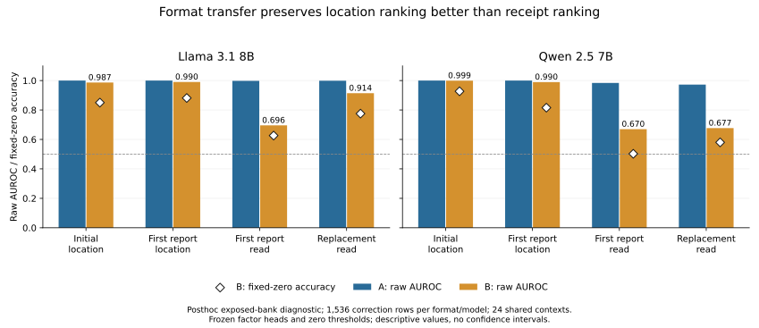

# Format failure diagnosis: location scores transfer better than receipt scores

26 November 2026. **The frozen readouts lose much more target ordering for
message-reading records than for location content under the alternate format.**
This sharpens the earlier A/B collapse into a testable measurement question.
It is a posthoc analysis of existing captures, not fresh confirmation, a
demonstration of the model's internal algorithm, or a new deception detector.
No language-model calls, classifier fits or threshold searches were needed.

## What was measured

The [completed diagnostic](results/format-score-shift-2026-11-26/README.md)
checks all 4,992 saved test rows per checkpoint and exactly pairs 2,496 A/B
formal states per model. Its original specification was sealed before raw
margin arrays were opened. Every source orientation and zero decision boundary
is retained; no absolute AUROC, direction reversal or test-selected site is used.

The main factor interpretation below pools **all easy and hard corrections**:
1,536 rows per format/model in the same 24 contexts. This pooling was added in a
separately sealed posthoc supplement after initial per-stratum outcomes were
seen. The reason matters: hard cases force `I = 1-M1`, while easy cases force
`I = M1`. An independent critic identified that the hard stratum alone cannot
establish separate decoding of those two variables. The union varies both
independently. The original specification, stratum outputs and study primary
endpoint remain unchanged.

| Frozen factor | Llama raw AUROC A to B | Qwen raw AUROC A to B |
| --- | ---: | ---: |
| Initial token location, I | 1.000 to **0.987** | 1.000 to **0.999** |
| First report's location, M1 | 1.000 to **0.990** | 1.000 to **0.990** |
| Accepted record: first report read, B1 | 0.998 to **0.696** | 0.984 to **0.670** |
| Accepted record: replacement read, B2 | 0.999 to **0.914** | 0.972 to **0.677** |

AUROC is a ranking measure: 0.5 is chance ordering and 1.0 is perfect ordering.
It is not percentage accuracy. Within-context positive/negative comparisons
retain the same pattern, limiting a simple between-context explanation. These
are separately fitted factor heads at the previous source-selected sites,
Llama layer 16 and Qwen layer 21 at the queried location. Their scales need
not match. The target is the fictional sender's accepted record of reading,
not independently measured access or a real reader's private belief.

## Why this is more informative than the aggregate drop

An additive score offset changes thresholded predictions but leaves ordering,
and therefore AUROC, unchanged. The receipt heads lose ordering as well as
accuracy, so one constant offset cannot restore their original discrimination.
This does not imply that another direction could not decode the same target.
It also does not identify which change inside B caused the loss.

There is a useful counterexample in the controls: Qwen S1 on directly asserted
B attributions predicts zero on all 192 rows, scoring 50% accuracy, yet retains
0.9936 raw AUROC. Both class means lie below zero. That control is compatible
with a boundary mismatch; treating it as absent information would be wrong.
The receipt failures are different. For Qwen B1, class-0 mean margin moves by
+6.5697 while class-1 mean moves by -0.1421. Its B class recalls are 0.0234 and
0.9818. It predicts 1 on 97.92% of correction rows, so its low world/name flip
rates do not establish useful invariance either.

The strongest bounded reading is therefore: **under these two frozen
instruments, transfer of reading-record information is less reliable than
transfer of initial/report location content.** This motivates a targeted
adaptation comparison. It does not show that the models have lost the
information, cannot reason about access, or spontaneously anticipate a reader.
The prompt format changes system instructions, narrative presentation and
question wording together; a causal explanation of a particular component
requires a controlled intervention.

## Verification and new software

The diagnostic author checked its outputs independently against standard
arithmetic libraries. A separate-author reconstruction additionally checked
**3,200 score scopes and 300 joint-factor scopes**, including every context,
for 36,100 scalar comparisons. Maximum absolute difference was 1.11e-16.
The [review receipt](validation/2026-11-26-format-score-independent-review-v1.json)
states the limits: it independently checks AUROC, fixed-zero accuracy, class
recalls/means and joint factor/fold accuracy, not every quantile or correlation.
The reviewer knew the headline outcomes. Source inspection separately found
no pairing, order/tie or nuisance-counterpart error. This is not human review.

The reusable [score diagnostic](../scripts/analyse_format_score_shift.py)
preserves all output attempts and exact ID joins. Its two executed source
versions are archived with their original reports. The current reusable file
received formatting only afterward; an
[AST comparison](validation/2026-11-26-format-score-source-formatting-v1.json)
verifies unchanged code structure. Eight diagnostic tests cover score direction,
ties, zero, nonfinite values, pairing, nuisance controls, the fold and overwrite
refusal. Historical source snapshots remain immutable.

The new [format-package builder](../src/latent_probes/format_bridge.py) crosses
A/B system, complete narrative and explicit question into all eight packages.
It covers all 64 correction states in each of the 24 existing contexts, yielding
12,288 potential prefixes per checkpoint. These contexts are already exposed.
The [preparation command](../scripts/prepare_format_bridge.py) checks donor
identity and diagonal reproduction, refuses to overwrite attempts, and can
compare exact diagonal token/prompt hashes with saved captures. Fourteen builder
tests include stale journal-ID removal, invalid donors and the completed-manifest
schema regression. Input preparation does not establish semantic acceptance or
measure hidden states. No bridge model captures have been collected.

The initial CPU-only preparation passed donor/token-prefix checks. The stronger
saved-reference preparation then failed because new code requested a diagnostic
manifest key from the original analysis-manifest schema. Its failed attempt and
sources were preserved. The corrected adapter uses `source_sha256` and has a
regression test. No model weights or scientific observations were involved.
Final preparation receipts are kept in the
[new review packet](review/format_bridge_v1/).
The corrected run validates all **24,576 complete token prefixes**, with
6,144 query-prefix identity controls per checkpoint and 3,072 diagonal
comparisons per checkpoint against saved prompt/token hashes, selected tokens
and positions. Maximum length is 790 tokens. All checks pass; their scope is
token availability and recorded-input identity, not model performance.
The [native export receipt](validation/2026-11-26-format-bridge-preflight-export-v1.json)
binds exact copied bytes and both stronger preparation attempts' source copies.

The combined diagnostic, builder and Windows launcher suite has **31 passing
tests** locally. The launcher integration test now explicitly requires a
registered local Ubuntu distribution; absent registration skips that local
integration, while an installed but failing distribution still fails. The
portable Windows canary/hash tests remain active. This addresses the previous
hosted-runner prerequisite gap without changing the completed scientific run.

## What the literature changes about the next study

The [new primary-source review](FORMAT_TRANSFER_RESEARCH_REVIEW_2026-11-26.md)
records actual reading coverage and versions rather than treating abstracts as
method verification. The closest preprint already tests style augmentation and
withheld-style evaluation: [Kumar, 2026](https://arxiv.org/abs/2605.27958).
The current [Bortoletto et al. version](https://arxiv.org/abs/2406.17513)
already studies belief-probe prompt brittleness. A generic format-repair claim
would have substantial prior overlap.

The sharper proposed comparison fixes capture and observation budget: A-only512
versus Mixed512 on identical formal states, with A-half256 and an intercept-only
adaptation using the same 256 A plus 256 B observations as Mixed512. Keep the
four targets and supplied rule common across C2 arms. Compare Mixed with the
intercept-only control to distinguish coefficient adaptation from a changed
boundary. Freeze the feature map and regularization convention; use entirely
new fitting/development/test contexts, retain all failed controls, and declare
B hard complete-quartet accuracy primary before any new test.

The [design review](FORMAT_TRANSFER_DESIGN_REVIEW_2026-11-26.md) gives exact
allocations, fixed package contrasts and an inventory including easier controls.
This is a proposed next experiment, not an executed result or a claim of
firstness. Human semantic review remains incomplete. The old A/B test bank
cannot become its fresh confirmation set through a new split.
