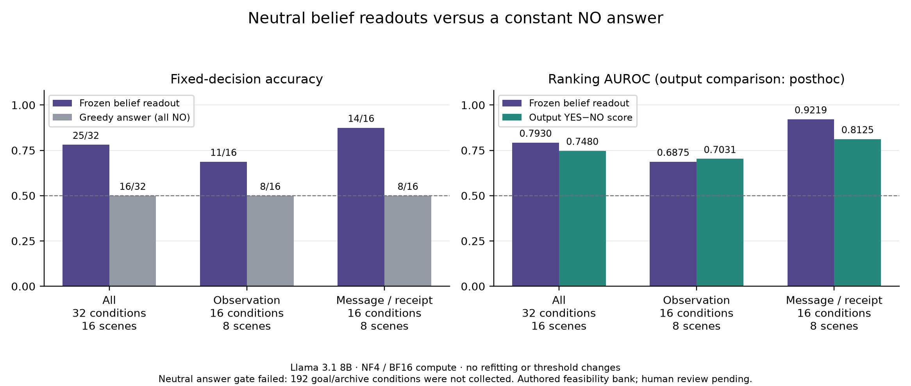

# Fresh neutral transfer: readout discrimination and constant verbal answers

**21 November 2026. Real local Llama 3.1 8B inference; exploratory feasibility.**
The unchanged belief readout scored **25/32**, while all 32 direct answers were
**NO**, giving **16/32** on the balanced labels. The readout passed every fixed
neutral floor, but the answer measure failed. The planned **192 goal/archive
conditions were not collected**. The goal-versus-quoted-content hypothesis is
therefore unanswered, and the full assay remains stopped.

## Measurements

| Neutral subset | Frozen belief readout | Direct answer | Readout AUROC |
| --- | --- | --- | --- |
| All conditions | 25/32 (78.1%) | 16/32 (50%) | .792969 |
| Observation-record channel | 11/16 | 8/16 | .687500 |
| Known-message/receipt channel | 14/16 | 8/16 | .921875 |
| Physical-name mapping 0 | 12/16 | 8/16 | — |
| Physical-name mapping 1 | 13/16 | 8/16 | — |

There were zero invalid or capped answers. Every output was exactly token IDs
`[9173, 128009]`, decoded as NO followed by the end-of-turn token. The probe's
confusion matrix is `[[13,3],[4,12]]` (true rows, predicted columns). Predictions
agree across physical-name swaps for 15 of the 16 scenes. World-location-only
and observation/receipt-polarity-only source-bit baselines each score 16/32;
these simple controls are not optimized text monitors.

The units are **16 authored scenes**, two mappings each, with eight wording
groups and two related evidence channels. The message result represents eight
scenes, not sixteen independent discoveries. Wording and evidence settings are
associated. Human semantic validation remains incomplete. AUROCs and simple
source-bit controls are descriptive neutral analyses, not evidence that the
future-goal comparison passed or a calibrated monitor beats capable text methods.

The target is the stipulated truth of the token/place_b proposition under the
sender's attributed reader perspective. These numbers are **not Apollo deception
detection accuracy**, actual-reader belief measurement or evidence of spontaneous
anticipation. The original Apollo adaptation remains a separate component.

## Interpretation and next diagnostic

The positive result is transfer of a previously trained readout to fresh
scenes, both name mappings and the new role/task scaffold without fitting.
Its discrimination is strongest on the message channel. This supports continuing
to investigate the instrument; it does not by itself establish a novel paper
contribution. The constant verbal answer prevents the proposed comparison of
goal-sensitive scores against reliable correct current-belief answers.

[Vector PDF](figures/2026-11-21/future_goal_neutral_controls.pdf) ·
[SVG](figures/2026-11-21/future_goal_neutral_controls.svg) ·
[Figure data](figures/2026-11-21/future_goal_neutral_controls.json).

After observing that collapse, a [separate posthoc output-head diagnostic](FUTURE_GOAL_ANSWER_LOGITS_PROTOCOL_V1.md)
was specified and frozen at commit `20d4101`. It reuses the exact 32 neutral
prefixes, captures next-token YES/NO scores with no generated answers, and
requires each same-forward block16 vector to equal its saved original exactly.
It tests whether output-score ranking survives the constant greedy decision.
It cannot change the failed gate or authorize the 192 uncollected conditions.

## Completed posthoc output-head comparison

The diagnostic completed **32 full-model forwards and zero new generated
answers**. Every same-forward block16 vector equals its original saved vector
exactly. All recorded full-vocabulary argmax IDs are 9173, matching the original
greedy NO. The bare YES and NO tokens are 14331 and 9173.

| Subset | Frozen readout AUROC | Output YES−NO AUROC |
| --- | --- | --- |
| All 32 conditions / 16 scenes | .792969 | .748047 |
| Observation: 16 conditions / 8 scenes | .687500 | .703125 |
| Message: 16 conditions / 8 scenes | .921875 | .812500 |

Relative output scores therefore retain sample-level label discrimination
despite constant greedy answers. The conditional YES probability ranges from
.182426 to .468791; every value remains below .5. No threshold or sign was
changed. This is compatible with an output preference for NO alongside some
retained information; it does not establish accurate internal beliefs.

The probe's largest descriptive advantage is in the message subset. Output
scores are slightly better on observation scenarios, so there is no uniform
latent advantage. The sample is small and these are paired development cases;
do not claim statistical superiority or broader transfer. Comparing these
values with older banks does not isolate a causal framing effect because the
cases and wording differ.

Output-head probability baselines already appear in [Schouten et al., Section 4.1](https://arxiv.org/html/2404.18865v1).
This diagnostic is a stronger baseline check, not a newly invented method.
It prevents equating a constant answer with absence of all label information.

The [bound output-score record](validation/2026-11-21-future-goal-answer-logits.json)
contains all 32 score pairs. Root and an independent read-only agent agree on
counts, AUROCs, prefix identities, feature hashes and scalar identities. The
native run is `/home/adirj/kcl-latent-probes-runs/future_goal_answer_logits_v1_20261121`;
its [Windows mirror](../runs/future_goal_answer_logits_v1_20261121/) has 35 files,
4,121,429 bytes, byte-identical to native. It ran from 14:29:18 to 14:32:56 UTC,
including weight loading. The full-vocabulary logits were not retained, so logZ
and argmax cannot independently be reconstructed; the saved scalar identities
and agreement with the original generated NO are verified. The primary
two-token score difference is retained directly.

## Next research decision

The useful development signal is transferable attributed-belief information,
particularly on message/receipt scenes, alongside a biased verbal decision.
The next larger study needs fresh, fully crossed materials, a frozen capable
behavioral/likelihood baseline and independent calibration/validation splits.
Do not retune a threshold on these 32 rows or continue the stopped 192 rows.
The future-goal question remains a candidate contribution, not a discovered
goal-contamination mechanism.

A controlled full-BF16 reference and a more capable model's neutral qualification
are reasonable CREATE experiments. NF4 versus full BF16 on the same checkpoint
tests a precision shift; changing model family/size is a separate comparison.
The NF4-trained head transferred to BF16 would be a cross-precision probe test,
not an automatically valid BF16 belief instrument. Bigger compute cannot be
assumed to fix the answer bias. Discuss the proposed target emphasis with the
supervisor before making it the final main-study endpoint.

## Execution and verification

- Prospective protocol/code checkpoint: `ac7e17d`.
- [Frozen feasibility protocol](FUTURE_GOAL_CONTENT_CONTROLS_PROTOCOL_V1.md) and
  [exact bank](../data/belief_diagnostic/future_goal_content_controls_draft_v1.json).
- Actual run: `/home/adirj/kcl-latent-probes-runs/future_goal_content_controls_v1_20261121`.
  It started at 14:08:22 UTC and finished at 14:12:59 UTC. Weight loading is
  included; 32 new answers were generated locally, with no API model calls.
- [Ignored Windows mirror](../runs/future_goal_content_controls_v1_20261121/):
  70 files, 3,915,852 bytes, independently byte-identical to the native run.
- Protocol SHA256: `e506e9433f6f39b60af299436c6d259c64fc387afc42b82c96ff04dccfbf13e2`.
- [Bound CPU verification](validation/2026-11-21-future-goal-content-controls-v2.json)
  repeats pinned tokenization/decoding, verifies source/fit/code/output hashes,
  recomputes feature scores and checks the exact stopped gate.
- A [separate root audit](validation/2026-11-21-future-goal-content-independent.json)
  rederives gold from source bits and frozen margins directly from saved arrays,
  without the project scoring helper. Maximum margin discrepancy is
  `8.326672684688674e-17`, with zero prediction disagreements.
- Source-reference prefix, full block16 feature and score were exact before the
  new rows. Hook checks agree with HF state17. No head, scaler, threshold, layer,
  source label, prompt or old fitted artifact was changed during collection.

## Analysis correction, without rerunning the experiment

The first CPU analyzer incorrectly required every model-generation EOS ID to
appear in `tokenizer.all_special_ids`. This checkpoint's generation EOS list is
`[128001,128008,128009]`, while the tokenizer exposes `[128000,128009]` through
that property. The identities are separate metadata. Every observed output
terminated with 128009; no saved generation was affected by the checker error.

The executed V1 analyzer remains unchanged at SHA256
`c6e16294942620135f76be679cbd4e899864d791a5db33ec51ecb4c17cef477c`.
The [V2 analyzer](../src/latent_probes/future_goal_controls_analysis_v2.py) removes
only that invalid subset assumption and adds explicit correction provenance.
Regression tests check the exact edit while retaining source EOS equality,
tokenizer identity, decoding, special-token disposition, all bindings, scores
and gate decisions. The CPU correction generated zero new observations and
fitted zero heads. It does not turn qualification into a pass.

The [human review packet](review/future_goal_controls_v1_human/review.md) contains
all sixteen current scenes without expected answers or model results; annotations
remain blank. All previous reader-dependent pipeline failures remain unchanged.
