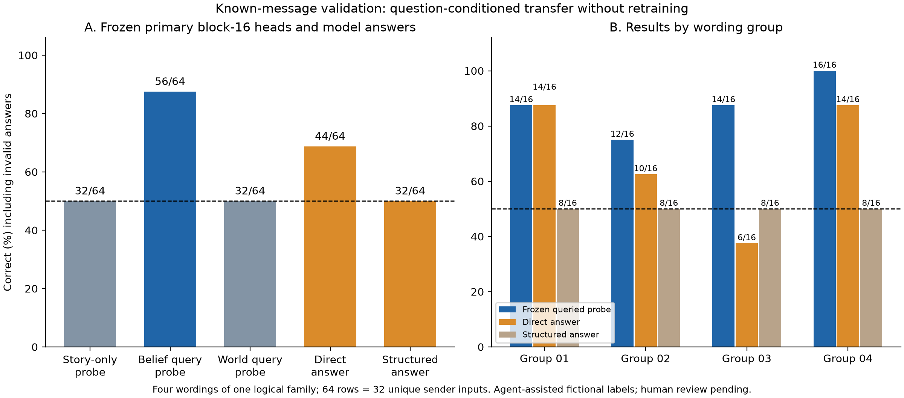

# Frozen belief readout transferred to a known message

**20 November 2026.** A neutral readout trained on prior-state observation stories
predicts sender-attributed reader belief on **56/64 known-message cases (87.5%)**
when the nested question is present. It was transferred unchanged: no new fitting,
layer choice, threshold selection or recalibration used these outcomes. On the
same cases without a question, the queried head scores **32/64**.

This is a promising **question-conditioned transfer across evidence channels**.
It is not yet an unqueried communication monitor, pressure transfer, spontaneous
second-order belief, causal reasoning or anticipation of an unknown future report.
There are **32 unique sender inputs represented by 64 paired rows**, across four
wordings of one logical family. The authored labels still need independent human
review. The full [curated numerical record](./validation/2026-11-20-known-message-validation.json)
preserves the measurements, source hashes and interpretation limits.



The [vector PDF](./figures/2026-11-20/known_message_validation.pdf) and
[SVG](./figures/2026-11-20/known_message_validation.svg) are rebuilt from the
committed curated record with `scripts/plot_known_message_validation.py`.

## What changed from the previous experiment

The [previous comparison](./QUERY_COMPARISON_RESULTS.md) found 24/32 fresh sender
cases decodable after the nested question, but no successful transfer to states
before that question. Its delivered-current controls made world truth, actual
reader belief and sender-attributed reader belief coincide.

This [prospectively frozen panel](./KNOWN_MESSAGE_PROTOCOL.md) gives the reader
an exact known location message. Its content can disagree with the actual world,
and actual delivery can disagree with the receipt trusted by the sender. The
reader explicitly trusts a delivered message, including when false. The sender
knows the world, message and update rules, but cannot independently see delivery.

Every wording group exhausts sixteen combinations:

| Source value | Meaning |
| --- | --- |
| W | Actual current location |
| M | Location claimed by the exact message |
| A | Whether the recipient actually fully reads the message |
| B | Whether the receipt trusted by the sender reports full reading |

The jointly observed initial location is `1-M`. For the proposition that the
token is in the second named location, labels are `world=W`, `reader=M if A else
1-M`, and `nested=M if B else 1-M`. These describe **stipulated fictional states**,
not measured beliefs inside an actual reader LM. Actual delivery is hidden from
sender-view inputs, so paired cases with opposing actual-reader labels have
identical inputs and features. Every such negative-control head remains exactly
50%, as required.

The message-update channel is new relative to the source observation task, but
the label composition retains the same XNOR structure. New names, places and
complete prompts are disjoint from both earlier banks. Four new wordings are not
four independently held-out reasoning families.

## Frozen-readout results

All counts below use the nested target and the previously declared zero-based
decoder block 16, corresponding to HF hidden-state index 17. Each head retains
its original source-condition training scaler, row normalization, coefficients
and intercept. Matched text heads retain their training vocabulary and IDF.
An equal-condition entry means the old head and new capture share the same
question condition; **no head was fitted on the known-message task**.

| New capture condition / corresponding old head | Sender correct | Sender log loss | Omniscient correct | Omniscient log loss |
| --- | --- | --- | --- | --- |
| Story, no perspective question | 32/64 | 0.692484 | 32/64 | 0.693147 |
| Nested-belief question | **56/64** | **0.641871** | **50/64** | **0.663250** |
| World-truth question | 32/64 | 0.693148 | 33/64 | 0.693340 |

Every matched nested-target TF-IDF head gets 32/64. This is a limited learned
text control, not proof of superiority over capable text reasoning. The world
question remains unmatched in length and position, so these comparisons do not
isolate a causal semantic effect of asking the nested question.

The queried sender head has confusion matrix `[[26,6],[2,30]]`, with true rows
and predicted columns ordered `[0,1]`. Negative recall is **81.25%**, positive
recall **93.75%**, and macro F1 **0.874510**. Its probabilities stay close to 0.5:
positive-class probabilities range from **0.4190 to 0.5626**. Accuracy here is
not evidence of calibration or reliable confidence under further shifts.

| Wording group | Story | Nested question | World question |
| --- | --- | --- | --- |
| km_t01 | 8/16 | 14/16 | 8/16 |
| km_t02 | 8/16 | 12/16 | 8/16 |
| km_t03 | 8/16 | 14/16 | 8/16 |
| km_t04 | 8/16 | 16/16 | 8/16 |

The four declared frozen cross-condition directions are story to nested, story
to world, nested to story, and world to story. **All four score 32/64 in both
views** for the primary nested target. In particular, the successful queried
sender head does not become a successful unqueried head on this task.

## Where it fails

All eight incorrect sender predictions are four unique inputs, each repeated
under two privately different delivery conditions. Every error has **W=1, M=0**:
the world is in the second location but the message falsely claims the first.

| Sender queried-head stratum | Correct |
| --- | --- |
| Message agrees with world truth | 32/32 |
| Message disagrees with world truth | 24/32 |
| Nested label agrees with world truth | 30/32 |
| Nested label disagrees with world truth | 26/32 |

The hardest source cell is `W=1, M=0, B=1`: only **2/8** rows are correct.
With the same world and message but receipt reporting non-delivery, it gets
6/8. Each of the other six world/message/receipt cells gets 8/8. These are
descriptive error strata, not new endpoints selected to establish significance.

Accurate and mistaken receipts both yield 28/32. That equality follows from the
paired hidden-delivery construction: sender inputs do not change when A changes.
It must not be presented as independent evidence that the head handles another
kind of uncertainty.

## Explicit answers and the text reasoning scaffold

After all prefix captures and frozen scoring were complete, the same model
answered the sender-view nested question. Direct answers had an eight-token cap;
the structured prompt had a 160-token cap and requested INITIAL, MESSAGE,
RECEIPT, ATTRIBUTED, then FINAL. Both were greedy, used the same visible evidence,
and had prospectively specified strict and secondary parsers. Capped outputs
remain invalid under both parsers and were never retried.

| Answer condition | Correct / all rows | Incorrect | Invalid, length capped | Unique inputs |
| --- | --- | --- | --- | --- |
| Direct YES/NO | 44/64 | 16 | 4 | 32 |
| Structured final answer | 32/64 | 32 | 0 | 32 |

The structured condition emits **FINAL: YES on all 32 unique inputs**. Its final
answer is therefore at the balanced-label baseline despite valid formatting.
The predeclared secondary parsers do not change either condition's score.
Adding a scaffold did not establish a strong text monitor.

A separately saved **post-hoc audit** inspected all 32 unique structured outputs
and the ten unique direct errors. It does not replace the prospective endpoint:

| Emitted structured-field diagnostic | Unique inputs |
| --- | --- |
| Correct initial location | 31/32 |
| Correct asserted message location | 32/32 |
| Correct receipt delivery polarity | 32/32 |
| Correct attributed location | 21/32 |
| All four coded slot targets correct | 21/32 |
| Attributed location contradicts final YES/NO | 19/32 |
| Correct attributed location but wrong final answer | 12/32 |

Receipt coding checks delivery polarity, not complete semantic correctness.
Three receipt fields mention a location, including two that say delivery to a
container rather than the person. Consequently, 21 matching coded slots are not
21 fully valid explanations. Emitted field correctness also does not identify
the model's internal causal reasoning.

For example, the output for `km_t01_w0_m1_a0_b0` was:

```text
INITIAL: brass recess
MESSAGE: pewter recess
RECEIPT: no delivery
ATTRIBUTED: brass recess

FINAL: YES
```

The candidate concerns the pewter recess. The attributed location is correct,
but FINAL should be NO. The paired private-delivery case repeats the same output.
The [curated record](./validation/2026-11-20-known-message-validation.json) includes
exact traces and source hashes. The full local post-hoc audit is preserved in
[known_message_behavior_audit_v1.json](../runs/known_message_behavior_audit_v1.json), SHA256
`fc359ddf504f5524f058da67beb41f73a3cbe392758dc20ea3f5c8fba024594f`.

At the unique-input level, the probe is correct on 28/32 and direct behavior on
22/32. They are both correct on 21, only the probe is correct on seven, only the
direct answer is correct on one, and both fail on three. This is a descriptive
comparison of a supervised readout with elicited behavior, not a conclusion that
the model knows more than it can say or that a competitive text monitor has been
beaten. The two approaches have different training histories and output demands.

## Provenance and independent numerical audit

Source and material were committed before execution at
`9592c752f87593f4ddbe1af4290264a3409b1122`. The protocol froze at
**11:27:15.671598 UTC**. First model execution began at **11:34:07.805050**;
all captures and scoring finished by **11:35:34.322711**, before behavioral
generation. The earliest generated-output file modification time is
11:35:35.079; the frozen executed source independently enforces this ordering.
Filesystem times alone are not a separate execution trace.

The run uses the same pinned Llama 3.1 8B Instruct revision
`0e9e39f249a16976918f6564b8830bc894c89659`, local 4-bit execution and BF16 compute.
No new checkpoint download or probe training was required. All original fit and
source artifacts remain unchanged; raw outputs remain local and ignored by Git.

An independent Node implementation, without fitting or model calls, verified:

- 384 capture rows from 288 unique prefixes; all 1,152 row/layer prefix bindings
  and all 384 source/condition/message/capture bindings.
- Six exact repeated-prefix checks and genuine HF reference indices 9/17/25 for
  decoder blocks 8/16/24. Every captured position is the final prompt token, ID
  271; no answer token enters the features.
- All **10,752 prediction rows**, including reconstructed TF-IDF, with maximum
  probability difference **1.3323e-15**.
- All **168 metric objects**, their class statistics and unchanged source C;
  all **28 hidden-reader negative-control metric cells**.
- 1,034 file-hash comparisons and 14 backend identity fields; new entities,
  template IDs and case IDs are disjoint from both earlier banks.

The complete run is locally saved in
[`runs/known_message_validation_v1`](../runs/known_message_validation_v1).
The committed [curated JSON](./validation/2026-11-20-known-message-validation.json)
records hashes of major run files, the panel, executed policies, frozen fits and
the behavioral audit. A fresh clone does not include private raw run directories.

## What this enables next

There is now a positive frozen transfer result to investigate alongside its
question dependence and localized false-message failures. Broader neutral
validation still needs human-reviewed cases, more reasoning structures and
question formulations, and stronger text comparators. This observed panel is
development evidence and cannot remain a future untouched holdout.

Only a validated target with matched visibility and capture time should transfer
into pressured communication. Preserve unqueried states as a comparison; do not
silently add the belief question and call the original unqueried transfer solved.
The [main-study gates](./MAIN_STUDY_GATES.md) remain applicable.

## Reproduction

From the repository in the existing WSL environment, with the original fitted
run available, choose a new output directory:

```bash
HF_HOME=.cache/huggingface-wsl HF_HUB_OFFLINE=1 TRANSFORMERS_OFFLINE=1 \
HF_HUB_DISABLE_TELEMETRY=1 TRITON_CACHE_DIR=.cache/triton-wsl \
OMP_NUM_THREADS=4 MKL_NUM_THREADS=4 \
.venv-wsl/bin/python scripts/run_message_belief_validation.py \
  --config configs/apollo_llama8b_4bit.json \
  --panel data/belief_diagnostic/known_message_validation_v1.json \
  --fit-dir runs/belief_query_comparison_v1/fits \
  --source-run runs/belief_query_comparison_v1 \
  --output runs/known_message_validation_reproduction
```

The runner refuses to overwrite or implicitly retry an existing run. This report
does not require or initiate a rerun.
