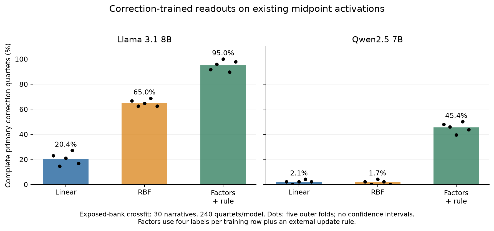

# Correction readout adequacy on the exposed activation bank

**Posthoc descriptive diagnostic.** Original test cases were already exposed; these are group-crossfit results, not fresh confirmation. All original study results remain unchanged.

Five outer folds keep all 64 variants of each narrative together. Each selected readout is refitted on 24 narratives (1,536 rows) and predicts six excluded narratives. Hyperparameter selection uses 18 separate inner-training and six inner-development groups. Every method receives one saved midpoint vector per prompt. There are 30 narrative units shared across models, 1,920 rows and 240 primary quartets per model. A quartet requires all four verdicts correct.

| Model | Readout | Primary quartet % | All rows % | Primary rows % | Secondary rows % |
| --- | --- | ---: | ---: | ---: | ---: |
| Llama | Direct linear | 20.42 | 78.85 | 74.06 | 83.65 |
| Llama | RBF classifier | 65.00 | 90.68 | 89.27 | 92.08 |
| Llama | Four factors + rule | 95.00 | 99.17 | 98.65 | 99.69 |
| Qwen | Direct linear | 2.08 | 56.88 | 63.23 | 50.52 |
| Qwen | RBF classifier | 1.67 | 57.14 | 62.92 | 51.35 |
| Qwen | Four factors + rule | 45.42 | 73.70 | 72.81 | 74.58 |

## Factor diagnostic and nuisance sensitivity

Four-factor decoding has four labels per training row plus the supplied Boolean update algorithm. It is a privileged diagnostic, not a supervision- or compute-matched improvement. RBF may retain all training examples as support vectors. Its margin is not a calibrated probability.

| Model | Initial % | Message value % | First receipt % | Final receipt % | All four factors % |
| --- | ---: | ---: | ---: | ---: | ---: |
| Llama | 99.69 | 99.74 | 98.12 | 99.74 | 97.34 |
| Qwen | 94.95 | 75.00 | 92.24 | 87.45 | 58.18 |

| Model | Readout | World flips % | Name-map flips % | Foldwise primary quartet % |
| --- | --- | ---: | ---: | --- |
| Llama | Direct linear | 17.71 | 18.75 | 22.9, 14.6, 20.8, 27.1, 16.7 |
| Llama | RBF classifier | 8.44 | 8.44 | 66.7, 62.5, 64.6, 68.8, 62.5 |
| Llama | Four factors + rule | 1.25 | 1.25 | 91.7, 95.8, 100.0, 89.6, 97.9 |
| Qwen | Direct linear | 22.08 | 14.58 | 2.1, 0.0, 2.1, 4.2, 2.1 |
| Qwen | RBF classifier | 16.56 | 15.31 | 2.1, 0.0, 4.2, 2.1, 0.0 |
| Qwen | Four factors + rule | 17.40 | 20.10 | 47.9, 45.8, 39.6, 50.0, 43.8 |

Failed inner candidates retained: **0**. Full selections, per-group/fold metrics, class recalls, receipt pairs and quartet histograms are in [the source-bound summary](summary.json).

## Interpretation limits

Success shows accessibility under correction supervision and this readout family. It does not make the original one-step-trained head transfer successfully. Comparing those earlier heads with these heads changes supervision, support, fitting size and selection, so it is not a causal estimate of adding correction examples. This diagnostic uses 1,536 outer-training rows, while the planned fresh test may use N512; success here cannot certify that smaller instrument.

The folds have overlapping training sets. Aggregate values and fold dots are descriptive; no naive bootstrap or significance test is reported. Both models share the same 30 narratives and renderer. Human semantic review is incomplete. These measurements concern sender-attributed reader belief under an explicit belief question, not spontaneous anticipation, deceptive intent or causal use of a belief representation.

All saved margins, train-only transforms, selected-grid records, folds and verdict metrics were reconstructed without importing or refitting the pipeline. That separate checking implementation was authored by the fitting-code author; implementation separation is not independent authorship. The output manifest binds the source analyses, audit and renderer. No new language-model calls were made.
