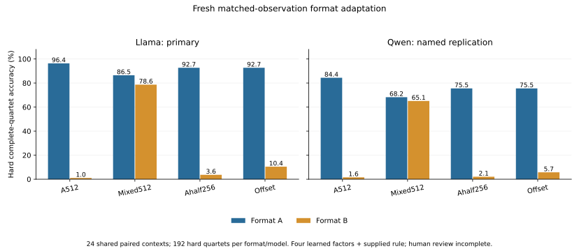

# Fresh matched-format adaptation: completed fixed comparison

Agent-audited exploratory. Human semantic review remains incomplete. Both models share 24 test contexts; the intervals condition on fixed fits and authoring.

All four arms receive four factor targets and the same supplied rule. Mixed versus Offset compares procedures, not a unique geometric mechanism.

| Model / format | A512 hard panels | Mixed512 | Ahalf256 | Offset |
| --- | ---: | ---: | ---: | ---: |
| llama / A | 185/192 (96.35%) | 166/192 (86.46%) | 178/192 (92.71%) | 178/192 (92.71%) |
| llama / B | 2/192 (1.04%) | 151/192 (78.65%) | 7/192 (3.65%) | 20/192 (10.42%) |
| qwen / A | 162/192 (84.38%) | 131/192 (68.23%) | 145/192 (75.52%) | 145/192 (75.52%) |
| qwen / B | 3/192 (1.56%) | 125/192 (65.10%) | 4/192 (2.08%) | 11/192 (5.73%) |

## Fixed primary and named diagnostic

```json
{
  "llama": {
    "primary": {
      "contrast": "Mixed512_minus_A512",
      "renderer": "B",
      "condition": "correction_hard",
      "endpoint": "complete_four_case_quartet_accuracy",
      "groups": 24,
      "quartets": 192,
      "Mixed512": 0.7864583333333334,
      "A512": 0.010416666666666666,
      "difference": 0.7760416666666666,
      "conditional_percentile_interval_95": [
        0.6822916666666666,
        0.8541666666666666
      ],
      "bootstrap_samples": 10000,
      "bootstrap_seed": 20261127,
      "uncertainty_scope": "Paired whole contexts conditional on frozen authored bank, old feature map, site and fitted heads; excludes coefficient/checkpoint uncertainty",
      "group_values": [
        {
          "group_id": "adapt_test_00",
          "Mixed512": 0.75,
          "A512": 0.0,
          "difference": 0.75
        },
        {
          "group_id": "adapt_test_01",
          "Mixed512": 0.75,
          "A512": 0.0,
          "difference": 0.75
        },
        {
          "group_id": "adapt_test_02",
          "Mixed512": 1.0,
          "A512": 0.0,
          "difference": 1.0
        },
        {
          "group_id": "adapt_test_03",
          "Mixed512": 0.625,
          "A512": 0.0,
          "difference": 0.625
        },
        {
          "group_id": "adapt_test_04",
          "Mixed512": 0.625,
          "A512": 0.0,
          "difference": 0.625
        },
        {
          "group_id": "adapt_test_05",
          "Mixed512": 0.625,
          "A512": 0.0,
          "difference": 0.625
        },
        {
          "group_id": "adapt_test_06",
          "Mixed512": 1.0,
          "A512": 0.0,
          "difference": 1.0
        },
        {
          "group_id": "adapt_test_07",
          "Mixed512": 1.0,
          "A512": 0.0,
          "difference": 1.0
        },
        {
          "group_id": "adapt_test_08",
          "Mixed512": 0.75,
          "A512": 0.0,
          "difference": 0.75
        },
        {
          "group_id": "adapt_test_09",
          "Mixed512": 0.625,
          "A512": 0.0,
          "difference": 0.625
        },
        {
          "group_id": "adapt_test_10",
          "Mixed512": 0.875,
          "A512": 0.0,
          "difference": 0.875
        },
        {
          "group_id": "adapt_test_11",
          "Mixed512": 0.75,
          "A512": 0.0,
          "difference": 0.75
        },
        {
          "group_id": "adapt_test_12",
          "Mixed512": 0.625,
          "A512": 0.0,
          "difference": 0.625
        },
        {
          "group_id": "adapt_test_13",
          "Mixed512": 1.0,
          "A512": 0.0,
          "difference": 1.0
        },
        {
          "group_id": "adapt_test_14",
          "Mixed512": 0.75,
          "A512": 0.125,
          "difference": 0.625
        },
        {
          "group_id": "adapt_test_15",
          "Mixed512": 0.875,
          "A512": 0.0,
          "difference": 0.875
        },
        {
          "group_id": "adapt_test_16",
          "Mixed512": 1.0,
          "A512": 0.125,
          "difference": 0.875
        },
        {
          "group_id": "adapt_test_17",
          "Mixed512": 0.875,
          "A512": 0.0,
          "difference": 0.875
        },
        {
          "group_id": "adapt_test_18",
          "Mixed512": 0.875,
          "A512": 0.0,
          "difference": 0.875
        },
        {
          "group_id": "adapt_test_19",
          "Mixed512": 0.0,
          "A512": 0.0,
          "difference": 0.0
        },
        {
          "group_id": "adapt_test_20",
          "Mixed512": 0.75,
          "A512": 0.0,
          "difference": 0.75
        },
        {
          "group_id": "adapt_test_21",
          "Mixed512": 0.75,
          "A512": 0.0,
          "difference": 0.75
        },
        {
          "group_id": "adapt_test_22",
          "Mixed512": 1.0,
          "A512": 0.0,
          "difference": 1.0
        },
        {
          "group_id": "adapt_test_23",
          "Mixed512": 1.0,
          "A512": 0.0,
          "difference": 1.0
        }
      ],
      "role": "primary"
    },
    "named_diagnostic": {
      "contrast": "Mixed512_minus_Offset",
      "renderer": "B",
      "condition": "correction_hard",
      "endpoint": "complete_four_case_quartet_accuracy",
      "groups": 24,
      "quartets": 192,
      "Mixed512": 0.7864583333333334,
      "Offset": 0.10416666666666667,
      "difference": 0.6822916666666666,
      "conditional_percentile_interval_95": [
        0.5885416666666666,
        0.7604166666666666
      ],
      "bootstrap_samples": 10000,
      "bootstrap_seed": 20261127,
      "uncertainty_scope": "Paired whole contexts conditional on frozen authored bank, old feature map, site and fitted heads; excludes coefficient/checkpoint uncertainty",
      "group_values": [
        {
          "group_id": "adapt_test_00",
          "Mixed512": 0.75,
          "Offset": 0.0,
          "difference": 0.75
        },
        {
          "group_id": "adapt_test_01",
          "Mixed512": 0.75,
          "Offset": 0.0,
          "difference": 0.75
        },
        {
          "group_id": "adapt_test_02",
          "Mixed512": 1.0,
          "Offset": 0.125,
          "difference": 0.875
        },
        {
          "group_id": "adapt_test_03",
          "Mixed512": 0.625,
          "Offset": 0.0,
          "difference": 0.625
        },
        {
          "group_id": "adapt_test_04",
          "Mixed512": 0.625,
          "Offset": 0.0,
          "difference": 0.625
        },
        {
          "group_id": "adapt_test_05",
          "Mixed512": 0.625,
          "Offset": 0.25,
          "difference": 0.375
        },
        {
          "group_id": "adapt_test_06",
          "Mixed512": 1.0,
          "Offset": 0.0,
          "difference": 1.0
        },
        {
          "group_id": "adapt_test_07",
          "Mixed512": 1.0,
          "Offset": 0.0,
          "difference": 1.0
        },
        {
          "group_id": "adapt_test_08",
          "Mixed512": 0.75,
          "Offset": 0.0,
          "difference": 0.75
        },
        {
          "group_id": "adapt_test_09",
          "Mixed512": 0.625,
          "Offset": 0.125,
          "difference": 0.5
        },
        {
          "group_id": "adapt_test_10",
          "Mixed512": 0.875,
          "Offset": 0.125,
          "difference": 0.75
        },
        {
          "group_id": "adapt_test_11",
          "Mixed512": 0.75,
          "Offset": 0.25,
          "difference": 0.5
        },
        {
          "group_id": "adapt_test_12",
          "Mixed512": 0.625,
          "Offset": 0.0,
          "difference": 0.625
        },
        {
          "group_id": "adapt_test_13",
          "Mixed512": 1.0,
          "Offset": 0.25,
          "difference": 0.75
        },
        {
          "group_id": "adapt_test_14",
          "Mixed512": 0.75,
          "Offset": 0.0,
          "difference": 0.75
        },
        {
          "group_id": "adapt_test_15",
          "Mixed512": 0.875,
          "Offset": 0.125,
          "difference": 0.75
        },
        {
          "group_id": "adapt_test_16",
          "Mixed512": 1.0,
          "Offset": 0.25,
          "difference": 0.75
        },
        {
          "group_id": "adapt_test_17",
          "Mixed512": 0.875,
          "Offset": 0.375,
          "difference": 0.5
        },
        {
          "group_id": "adapt_test_18",
          "Mixed512": 0.875,
          "Offset": 0.25,
          "difference": 0.625
        },
        {
          "group_id": "adapt_test_19",
          "Mixed512": 0.0,
          "Offset": 0.0,
          "difference": 0.0
        },
        {
          "group_id": "adapt_test_20",
          "Mixed512": 0.75,
          "Offset": 0.125,
          "difference": 0.625
        },
        {
          "group_id": "adapt_test_21",
          "Mixed512": 0.75,
          "Offset": 0.125,
          "difference": 0.625
        },
        {
          "group_id": "adapt_test_22",
          "Mixed512": 1.0,
          "Offset": 0.125,
          "difference": 0.875
        },
        {
          "group_id": "adapt_test_23",
          "Mixed512": 1.0,
          "Offset": 0.0,
          "difference": 1.0
        }
      ],
      "interpretation": "Difference between fixed fitting procedures at equal observed A/B budget; not a unique geometric or mechanistic attribution"
    }
  },
  "qwen": {
    "primary": {
      "contrast": "Mixed512_minus_A512",
      "renderer": "B",
      "condition": "correction_hard",
      "endpoint": "complete_four_case_quartet_accuracy",
      "groups": 24,
      "quartets": 192,
      "Mixed512": 0.6510416666666666,
      "A512": 0.015625,
      "difference": 0.6354166666666666,
      "conditional_percentile_interval_95": [
        0.546875,
        0.7135416666666666
      ],
      "bootstrap_samples": 10000,
      "bootstrap_seed": 20261127,
      "uncertainty_scope": "Paired whole contexts conditional on frozen authored bank, old feature map, site and fitted heads; excludes coefficient/checkpoint uncertainty",
      "group_values": [
        {
          "group_id": "adapt_test_00",
          "Mixed512": 0.875,
          "A512": 0.0,
          "difference": 0.875
        },
        {
          "group_id": "adapt_test_01",
          "Mixed512": 0.75,
          "A512": 0.0,
          "difference": 0.75
        },
        {
          "group_id": "adapt_test_02",
          "Mixed512": 0.75,
          "A512": 0.0,
          "difference": 0.75
        },
        {
          "group_id": "adapt_test_03",
          "Mixed512": 0.75,
          "A512": 0.0,
          "difference": 0.75
        },
        {
          "group_id": "adapt_test_04",
          "Mixed512": 0.375,
          "A512": 0.0,
          "difference": 0.375
        },
        {
          "group_id": "adapt_test_05",
          "Mixed512": 0.875,
          "A512": 0.0,
          "difference": 0.875
        },
        {
          "group_id": "adapt_test_06",
          "Mixed512": 0.625,
          "A512": 0.0,
          "difference": 0.625
        },
        {
          "group_id": "adapt_test_07",
          "Mixed512": 0.5,
          "A512": 0.0,
          "difference": 0.5
        },
        {
          "group_id": "adapt_test_08",
          "Mixed512": 0.875,
          "A512": 0.0,
          "difference": 0.875
        },
        {
          "group_id": "adapt_test_09",
          "Mixed512": 0.75,
          "A512": 0.125,
          "difference": 0.625
        },
        {
          "group_id": "adapt_test_10",
          "Mixed512": 0.875,
          "A512": 0.0,
          "difference": 0.875
        },
        {
          "group_id": "adapt_test_11",
          "Mixed512": 0.125,
          "A512": 0.125,
          "difference": 0.0
        },
        {
          "group_id": "adapt_test_12",
          "Mixed512": 0.625,
          "A512": 0.0,
          "difference": 0.625
        },
        {
          "group_id": "adapt_test_13",
          "Mixed512": 0.625,
          "A512": 0.0,
          "difference": 0.625
        },
        {
          "group_id": "adapt_test_14",
          "Mixed512": 0.75,
          "A512": 0.125,
          "difference": 0.625
        },
        {
          "group_id": "adapt_test_15",
          "Mixed512": 0.625,
          "A512": 0.0,
          "difference": 0.625
        },
        {
          "group_id": "adapt_test_16",
          "Mixed512": 0.875,
          "A512": 0.0,
          "difference": 0.875
        },
        {
          "group_id": "adapt_test_17",
          "Mixed512": 0.75,
          "A512": 0.0,
          "difference": 0.75
        },
        {
          "group_id": "adapt_test_18",
          "Mixed512": 0.5,
          "A512": 0.0,
          "difference": 0.5
        },
        {
          "group_id": "adapt_test_19",
          "Mixed512": 0.25,
          "A512": 0.0,
          "difference": 0.25
        },
        {
          "group_id": "adapt_test_20",
          "Mixed512": 0.5,
          "A512": 0.0,
          "difference": 0.5
        },
        {
          "group_id": "adapt_test_21",
          "Mixed512": 0.5,
          "A512": 0.0,
          "difference": 0.5
        },
        {
          "group_id": "adapt_test_22",
          "Mixed512": 0.75,
          "A512": 0.0,
          "difference": 0.75
        },
        {
          "group_id": "adapt_test_23",
          "Mixed512": 0.75,
          "A512": 0.0,
          "difference": 0.75
        }
      ],
      "role": "named_secondary_replication"
    },
    "named_diagnostic": {
      "contrast": "Mixed512_minus_Offset",
      "renderer": "B",
      "condition": "correction_hard",
      "endpoint": "complete_four_case_quartet_accuracy",
      "groups": 24,
      "quartets": 192,
      "Mixed512": 0.6510416666666666,
      "Offset": 0.057291666666666664,
      "difference": 0.59375,
      "conditional_percentile_interval_95": [
        0.5104166666666666,
        0.671875
      ],
      "bootstrap_samples": 10000,
      "bootstrap_seed": 20261127,
      "uncertainty_scope": "Paired whole contexts conditional on frozen authored bank, old feature map, site and fitted heads; excludes coefficient/checkpoint uncertainty",
      "group_values": [
        {
          "group_id": "adapt_test_00",
          "Mixed512": 0.875,
          "Offset": 0.0,
          "difference": 0.875
        },
        {
          "group_id": "adapt_test_01",
          "Mixed512": 0.75,
          "Offset": 0.0,
          "difference": 0.75
        },
        {
          "group_id": "adapt_test_02",
          "Mixed512": 0.75,
          "Offset": 0.0,
          "difference": 0.75
        },
        {
          "group_id": "adapt_test_03",
          "Mixed512": 0.75,
          "Offset": 0.0,
          "difference": 0.75
        },
        {
          "group_id": "adapt_test_04",
          "Mixed512": 0.375,
          "Offset": 0.0,
          "difference": 0.375
        },
        {
          "group_id": "adapt_test_05",
          "Mixed512": 0.875,
          "Offset": 0.0,
          "difference": 0.875
        },
        {
          "group_id": "adapt_test_06",
          "Mixed512": 0.625,
          "Offset": 0.0,
          "difference": 0.625
        },
        {
          "group_id": "adapt_test_07",
          "Mixed512": 0.5,
          "Offset": 0.0,
          "difference": 0.5
        },
        {
          "group_id": "adapt_test_08",
          "Mixed512": 0.875,
          "Offset": 0.0,
          "difference": 0.875
        },
        {
          "group_id": "adapt_test_09",
          "Mixed512": 0.75,
          "Offset": 0.125,
          "difference": 0.625
        },
        {
          "group_id": "adapt_test_10",
          "Mixed512": 0.875,
          "Offset": 0.125,
          "difference": 0.75
        },
        {
          "group_id": "adapt_test_11",
          "Mixed512": 0.125,
          "Offset": 0.0,
          "difference": 0.125
        },
        {
          "group_id": "adapt_test_12",
          "Mixed512": 0.625,
          "Offset": 0.0,
          "difference": 0.625
        },
        {
          "group_id": "adapt_test_13",
          "Mixed512": 0.625,
          "Offset": 0.125,
          "difference": 0.5
        },
        {
          "group_id": "adapt_test_14",
          "Mixed512": 0.75,
          "Offset": 0.125,
          "difference": 0.625
        },
        {
          "group_id": "adapt_test_15",
          "Mixed512": 0.625,
          "Offset": 0.25,
          "difference": 0.375
        },
        {
          "group_id": "adapt_test_16",
          "Mixed512": 0.875,
          "Offset": 0.0,
          "difference": 0.875
        },
        {
          "group_id": "adapt_test_17",
          "Mixed512": 0.75,
          "Offset": 0.375,
          "difference": 0.375
        },
        {
          "group_id": "adapt_test_18",
          "Mixed512": 0.5,
          "Offset": 0.0,
          "difference": 0.5
        },
        {
          "group_id": "adapt_test_19",
          "Mixed512": 0.25,
          "Offset": 0.0,
          "difference": 0.25
        },
        {
          "group_id": "adapt_test_20",
          "Mixed512": 0.5,
          "Offset": 0.125,
          "difference": 0.375
        },
        {
          "group_id": "adapt_test_21",
          "Mixed512": 0.5,
          "Offset": 0.0,
          "difference": 0.5
        },
        {
          "group_id": "adapt_test_22",
          "Mixed512": 0.75,
          "Offset": 0.0,
          "difference": 0.75
        },
        {
          "group_id": "adapt_test_23",
          "Mixed512": 0.75,
          "Offset": 0.125,
          "difference": 0.625
        }
      ],
      "interpretation": "Difference between fixed fitting procedures at equal observed A/B budget; not a unique geometric or mechanistic attribution"
    }
  }
}
```

## Every arm, format and condition

| Model | Arm | Stratum | Correct rows | Row accuracy | Complete panels |
| --- | --- | --- | ---: | ---: | ---: |
| llama | A512 | A/one_step | 552/768 | 71.88% | 55/192 |
| llama | A512 | A/correction_easy | 758/768 | 98.70% | 184/192 |
| llama | A512 | A/correction_hard | 761/768 | 99.09% | 185/192 |
| llama | A512 | A/asserted | 139/192 | 72.40% | 0/0 |
| llama | A512 | B/one_step | 415/768 | 54.04% | 22/192 |
| llama | A512 | B/correction_easy | 547/768 | 71.22% | 66/192 |
| llama | A512 | B/correction_hard | 445/768 | 57.94% | 2/192 |
| llama | A512 | B/asserted | 108/192 | 56.25% | 0/0 |
| llama | Mixed512 | A/one_step | 556/768 | 72.40% | 41/192 |
| llama | Mixed512 | A/correction_easy | 744/768 | 96.88% | 173/192 |
| llama | Mixed512 | A/correction_hard | 737/768 | 95.96% | 166/192 |
| llama | Mixed512 | A/asserted | 177/192 | 92.19% | 0/0 |
| llama | Mixed512 | B/one_step | 396/768 | 51.56% | 5/192 |
| llama | Mixed512 | B/correction_easy | 739/768 | 96.22% | 169/192 |
| llama | Mixed512 | B/correction_hard | 726/768 | 94.53% | 151/192 |
| llama | Mixed512 | B/asserted | 178/192 | 92.71% | 0/0 |
| llama | Ahalf256 | A/one_step | 554/768 | 72.14% | 55/192 |
| llama | Ahalf256 | A/correction_easy | 753/768 | 98.05% | 180/192 |
| llama | Ahalf256 | A/correction_hard | 751/768 | 97.79% | 178/192 |
| llama | Ahalf256 | A/asserted | 122/192 | 63.54% | 0/0 |
| llama | Ahalf256 | B/one_step | 485/768 | 63.15% | 34/192 |
| llama | Ahalf256 | B/correction_easy | 560/768 | 72.92% | 56/192 |
| llama | Ahalf256 | B/correction_hard | 461/768 | 60.03% | 7/192 |
| llama | Ahalf256 | B/asserted | 127/192 | 66.15% | 0/0 |
| llama | Offset | A/one_step | 554/768 | 72.14% | 55/192 |
| llama | Offset | A/correction_easy | 753/768 | 98.05% | 180/192 |
| llama | Offset | A/correction_hard | 751/768 | 97.79% | 178/192 |
| llama | Offset | A/asserted | 122/192 | 63.54% | 0/0 |
| llama | Offset | B/one_step | 549/768 | 71.48% | 47/192 |
| llama | Offset | B/correction_easy | 585/768 | 76.17% | 67/192 |
| llama | Offset | B/correction_hard | 456/768 | 59.38% | 20/192 |
| llama | Offset | B/asserted | 132/192 | 68.75% | 0/0 |
| qwen | A512 | A/one_step | 487/768 | 63.41% | 45/192 |
| qwen | A512 | A/correction_easy | 752/768 | 97.92% | 178/192 |
| qwen | A512 | A/correction_hard | 736/768 | 95.83% | 162/192 |
| qwen | A512 | A/asserted | 143/192 | 74.48% | 0/0 |
| qwen | A512 | B/one_step | 396/768 | 51.56% | 0/192 |
| qwen | A512 | B/correction_easy | 466/768 | 60.68% | 29/192 |
| qwen | A512 | B/correction_hard | 329/768 | 42.84% | 3/192 |
| qwen | A512 | B/asserted | 103/192 | 53.65% | 0/0 |
| qwen | Mixed512 | A/one_step | 545/768 | 70.96% | 52/192 |
| qwen | Mixed512 | A/correction_easy | 706/768 | 91.93% | 144/192 |
| qwen | Mixed512 | A/correction_hard | 702/768 | 91.41% | 131/192 |
| qwen | Mixed512 | A/asserted | 148/192 | 77.08% | 0/0 |
| qwen | Mixed512 | B/one_step | 531/768 | 69.14% | 34/192 |
| qwen | Mixed512 | B/correction_easy | 685/768 | 89.19% | 128/192 |
| qwen | Mixed512 | B/correction_hard | 685/768 | 89.19% | 125/192 |
| qwen | Mixed512 | B/asserted | 125/192 | 65.10% | 0/0 |
| qwen | Ahalf256 | A/one_step | 530/768 | 69.01% | 48/192 |
| qwen | Ahalf256 | A/correction_easy | 742/768 | 96.61% | 174/192 |
| qwen | Ahalf256 | A/correction_hard | 718/768 | 93.49% | 145/192 |
| qwen | Ahalf256 | A/asserted | 163/192 | 84.90% | 0/0 |
| qwen | Ahalf256 | B/one_step | 454/768 | 59.11% | 7/192 |
| qwen | Ahalf256 | B/correction_easy | 453/768 | 58.98% | 23/192 |
| qwen | Ahalf256 | B/correction_hard | 342/768 | 44.53% | 4/192 |
| qwen | Ahalf256 | B/asserted | 105/192 | 54.69% | 0/0 |
| qwen | Offset | A/one_step | 530/768 | 69.01% | 48/192 |
| qwen | Offset | A/correction_easy | 742/768 | 96.61% | 174/192 |
| qwen | Offset | A/correction_hard | 718/768 | 93.49% | 145/192 |
| qwen | Offset | A/asserted | 163/192 | 84.90% | 0/0 |
| qwen | Offset | B/one_step | 546/768 | 71.09% | 31/192 |
| qwen | Offset | B/correction_easy | 500/768 | 65.10% | 34/192 |
| qwen | Offset | B/correction_hard | 454/768 | 59.11% | 11/192 |
| qwen | Offset | B/asserted | 142/192 | 73.96% | 0/0 |

Full class recalls, per-context values, factor diagnostics, nuisance controls, conditional output and strict first-token diagnostics are in [summary.json](summary.json). Four-factor truth applies only to correction conditions. One-step/asserted scores are out-of-training-construct controls, not separate four-factor validation.



The source and prediction archives, row journals, both-model pretest seal, failed-attempt evidence (if any), and independently frozen reconstructions remain in the bound native campaign/audit folders. No test-selected result replaces the Llama Mixed-minus-A512 primary.
