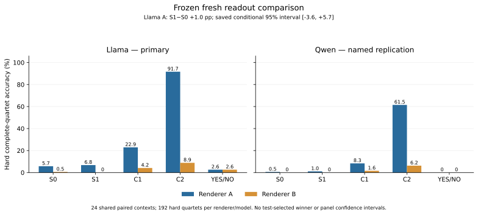

# Fresh readout study: frozen pipeline comparison

Agent-audited exploratory; human semantic review remains incomplete. This is not a confirmatory result.

Llama renderer-A hard complete-quartet S1−S0: **+1.04 percentage points**; saved conditional 95% interval **[-3.65, +5.73]**. The saved bootstrap uses 10,000 whole-context draws, seed 20261122, over 24 paired contexts and 192 hard quartets per renderer/model. The interval conditions on authored contexts, two renderers, selected sites and fitted heads; it does not cover their construction uncertainty.

Qwen is the predeclared replication, retained with S1−S0 **+0.52 percentage points**. Both models share the same 24 contexts; they do not provide 48 independent contextual units. No model or method was removed on the basis of its performance.

## Frozen source selection and controls

| Model | S0 site | S0 C | S1 site | S1 C |
| --- | --- | ---: | --- | ---: |
| Llama | layer_16_prompt_last | 10 | layer_16_query_location_last | 10 |
| Qwen | layer_14_prompt_last | 10 | layer_21_query_location_last | 10 |

Source fitting and source-development selection use separate original N512 partitions. Each of the twelve source sites has its own frozen development-selected C. S0 is the original site; S1 was selected using source development only. The twelve-site panel remains descriptive: no fresh-test winner is selected. C1 and C2 use the same S1 site, separate correction N512 fitting and N512 development partitions, and no development absorption.
The source fit covers 32 existing observation/message groups; correction fitting covers 16 new correction groups. Equal row count does not hold story count or mechanism mix fixed, so this comparison does not isolate a causal effect of adding one correction operator.

C2 predicts four separately supervised factors and applies an externally supplied update fold. Those extra labels and computation are privileged; C1 versus C2 is not an equal-capacity intervention. Earlier exposed cached factor results used 1,536 outer-training rows, whereas these fresh controls fit 512 rows. Cached success does not certify this smaller instrument.

## Every method and stratum

Values are percentages. R0/R1 are class recalls; world/name are verdict-flip rates. B1/B2 changing and preserving entries are both-counterparts-correct rates. “—” indicates an inapplicable metric or no eligible pairs. Four-case panels in one-step/easy strata retain their own label structure and are not assigned an independent-cell chance rate.

### A/one_step

| Model | Method | Row | Panel/quartet | R0 | R1 | World flip | Name flip | B1 changing | B1 preserving | B2 changing | B2 preserving | Raw AUROC |
| --- | --- | ---: | ---: | ---: | ---: | ---: | ---: | ---: | ---: | ---: | ---: | ---: |
| Llama | S0 | 79.04 | 17.19 | 68.49 | 89.58 | 9.64 | 12.24 | — | — | 17.19 | 100.00 | 0.917 |
| Llama | S1 | 86.72 | 46.88 | 88.02 | 85.42 | 10.94 | 16.15 | — | — | 46.88 | 100.00 | 0.950 |
| Llama | C1 | 79.04 | 16.67 | 70.57 | 87.50 | 22.14 | 8.07 | — | — | 17.19 | 99.48 | 0.902 |
| Llama | C2 | 69.66 | 16.15 | 77.34 | 61.98 | 21.09 | 14.84 | — | — | 22.92 | 56.77 | — |
| Llama | output | 72.14 | 10.94 | 87.76 | 56.51 | 17.19 | 13.02 | — | — | 23.44 | 75.00 | 0.826 |
| Llama | source_layer_8_account_last | 71.48 | 8.33 | 70.05 | 72.92 | 8.59 | 9.11 | — | — | 8.33 | 91.15 | 0.808 |
| Llama | source_layer_8_query_location_last | 76.04 | 6.25 | 71.35 | 80.73 | 13.54 | 18.75 | — | — | 6.25 | 100.00 | 0.877 |
| Llama | source_layer_8_prompt_last | 73.18 | 5.73 | 60.16 | 86.20 | 7.81 | 10.42 | — | — | 5.73 | 95.83 | 0.831 |
| Llama | source_layer_16_account_last | 72.53 | 6.25 | 56.77 | 88.28 | 6.51 | 5.99 | — | — | 6.25 | 94.79 | 0.811 |
| Llama | source_layer_16_query_location_last | 86.72 | 46.88 | 88.02 | 85.42 | 10.94 | 16.15 | — | — | 46.88 | 100.00 | 0.950 |
| Llama | source_layer_16_prompt_last | 79.04 | 17.19 | 68.49 | 89.58 | 9.64 | 12.24 | — | — | 17.19 | 100.00 | 0.917 |
| Llama | source_layer_24_account_last | 72.79 | 6.25 | 67.19 | 78.39 | 8.07 | 11.20 | — | — | 6.25 | 96.35 | 0.816 |
| Llama | source_layer_24_query_location_last | 83.20 | 32.81 | 77.86 | 88.54 | 12.76 | 19.53 | — | — | 32.81 | 100.00 | 0.942 |
| Llama | source_layer_24_prompt_last | 80.21 | 20.83 | 66.93 | 93.49 | 9.90 | 11.46 | — | — | 20.83 | 100.00 | 0.919 |
| Llama | source_layer_30_account_last | 72.79 | 7.81 | 64.32 | 81.25 | 9.11 | 7.03 | — | — | 7.81 | 96.35 | 0.823 |
| Llama | source_layer_30_query_location_last | 80.86 | 23.96 | 68.49 | 93.23 | 13.28 | 14.32 | — | — | 23.96 | 100.00 | 0.929 |
| Llama | source_layer_30_prompt_last | 80.34 | 22.92 | 76.04 | 84.64 | 10.68 | 11.20 | — | — | 22.92 | 100.00 | 0.907 |
| Qwen | S0 | 70.44 | 5.73 | 78.12 | 62.76 | 10.16 | 9.64 | — | — | 5.73 | 86.46 | 0.795 |
| Qwen | S1 | 83.46 | 34.90 | 91.93 | 75.00 | 14.32 | 15.89 | — | — | 34.90 | 100.00 | 0.933 |
| Qwen | C1 | 81.90 | 28.65 | 75.00 | 88.80 | 17.45 | 13.28 | — | — | 28.65 | 100.00 | 0.918 |
| Qwen | C2 | 54.30 | 12.50 | 37.24 | 71.35 | 41.93 | 19.01 | — | — | 16.67 | 39.06 | — |
| Qwen | output | 64.97 | 7.81 | 94.01 | 35.94 | 24.74 | 5.47 | — | — | 15.10 | 65.62 | 0.844 |
| Qwen | source_layer_7_account_last | 64.58 | 8.85 | 77.60 | 51.56 | 11.98 | 16.15 | — | — | 8.85 | 75.00 | 0.715 |
| Qwen | source_layer_7_query_location_last | 74.74 | 2.60 | 72.92 | 76.56 | 15.62 | 15.10 | — | — | 2.60 | 100.00 | 0.873 |
| Qwen | source_layer_7_prompt_last | 68.75 | 5.73 | 57.29 | 80.21 | 13.02 | 10.42 | — | — | 5.73 | 83.33 | 0.757 |
| Qwen | source_layer_14_account_last | 73.05 | 10.42 | 72.14 | 73.96 | 7.55 | 8.07 | — | — | 11.46 | 89.58 | 0.811 |
| Qwen | source_layer_14_query_location_last | 76.95 | 9.90 | 74.22 | 79.69 | 13.28 | 19.01 | — | — | 9.90 | 100.00 | 0.882 |
| Qwen | source_layer_14_prompt_last | 70.44 | 5.73 | 78.12 | 62.76 | 10.16 | 9.64 | — | — | 5.73 | 86.46 | 0.795 |
| Qwen | source_layer_21_account_last | 74.35 | 2.08 | 54.69 | 94.01 | 4.95 | 5.47 | — | — | 2.08 | 97.92 | 0.834 |
| Qwen | source_layer_21_query_location_last | 83.46 | 34.90 | 91.93 | 75.00 | 14.32 | 15.89 | — | — | 34.90 | 100.00 | 0.933 |
| Qwen | source_layer_21_prompt_last | 80.86 | 25.00 | 85.94 | 75.78 | 23.70 | 14.32 | — | — | 25.00 | 100.00 | 0.916 |
| Qwen | source_layer_26_account_last | 72.79 | 4.17 | 55.21 | 90.36 | 11.20 | 9.11 | — | — | 4.69 | 94.79 | 0.810 |
| Qwen | source_layer_26_query_location_last | 82.55 | 30.21 | 88.80 | 76.30 | 16.67 | 14.58 | — | — | 30.21 | 100.00 | 0.923 |
| Qwen | source_layer_26_prompt_last | 79.04 | 18.23 | 87.76 | 70.31 | 20.05 | 10.16 | — | — | 18.23 | 100.00 | 0.907 |

### A/correction_easy

| Model | Method | Row | Panel/quartet | R0 | R1 | World flip | Name flip | B1 changing | B1 preserving | B2 changing | B2 preserving | Raw AUROC |
| --- | --- | ---: | ---: | ---: | ---: | ---: | ---: | ---: | ---: | ---: | ---: | ---: |
| Llama | S0 | 57.81 | 10.94 | 52.34 | 63.28 | 15.10 | 6.25 | — | 54.95 | 15.62 | — | 0.620 |
| Llama | S1 | 62.24 | 18.75 | 64.58 | 59.90 | 22.92 | 18.23 | — | 59.11 | 24.74 | — | 0.673 |
| Llama | C1 | 87.89 | 65.62 | 89.06 | 86.72 | 16.41 | 14.84 | — | 82.81 | 75.78 | — | 0.950 |
| Llama | C2 | 98.18 | 93.75 | 98.44 | 97.92 | 3.12 | 2.60 | — | 96.88 | 96.35 | — | — |
| Llama | output | 59.51 | 11.46 | 93.23 | 25.78 | 22.66 | 13.80 | — | 52.08 | 20.83 | — | 0.740 |
| Llama | source_layer_8_account_last | 52.47 | 1.04 | 49.22 | 55.73 | 7.55 | 7.55 | — | 46.88 | 8.07 | — | 0.501 |
| Llama | source_layer_8_query_location_last | 50.00 | 0.00 | 50.00 | 50.00 | 0.00 | 0.00 | — | 50.00 | 0.00 | — | 0.509 |
| Llama | source_layer_8_prompt_last | 50.00 | 0.00 | 44.79 | 55.21 | 3.65 | 5.21 | — | 48.44 | 0.78 | — | 0.503 |
| Llama | source_layer_16_account_last | 47.79 | 0.00 | 51.82 | 43.75 | 3.39 | 4.43 | — | 44.53 | 1.04 | — | 0.490 |
| Llama | source_layer_16_query_location_last | 62.24 | 18.75 | 64.58 | 59.90 | 22.92 | 18.23 | — | 59.11 | 24.74 | — | 0.673 |
| Llama | source_layer_16_prompt_last | 57.81 | 10.94 | 52.34 | 63.28 | 15.10 | 6.25 | — | 54.95 | 15.62 | — | 0.620 |
| Llama | source_layer_24_account_last | 47.79 | 0.52 | 53.91 | 41.67 | 5.99 | 6.51 | — | 42.97 | 3.91 | — | 0.491 |
| Llama | source_layer_24_query_location_last | 59.38 | 14.06 | 52.08 | 66.67 | 15.10 | 10.94 | — | 57.03 | 18.75 | — | 0.639 |
| Llama | source_layer_24_prompt_last | 60.42 | 15.10 | 48.44 | 72.40 | 21.35 | 4.69 | — | 57.55 | 20.83 | — | 0.620 |
| Llama | source_layer_30_account_last | 51.17 | 0.00 | 44.01 | 58.33 | 9.64 | 4.95 | — | 46.09 | 6.51 | — | 0.498 |
| Llama | source_layer_30_query_location_last | 58.33 | 13.02 | 43.75 | 72.92 | 18.23 | 10.94 | — | 56.51 | 16.67 | — | 0.617 |
| Llama | source_layer_30_prompt_last | 59.24 | 10.94 | 67.19 | 51.30 | 23.18 | 13.28 | — | 53.65 | 20.05 | — | 0.639 |
| Qwen | S0 | 48.70 | 0.52 | 28.12 | 69.27 | 15.10 | 10.42 | — | 44.79 | 3.12 | — | 0.495 |
| Qwen | S1 | 51.43 | 0.52 | 83.07 | 19.79 | 35.68 | 7.55 | — | 49.48 | 3.39 | — | 0.594 |
| Qwen | C1 | 66.54 | 21.35 | 71.35 | 61.72 | 27.86 | 25.78 | — | 60.42 | 33.07 | — | 0.737 |
| Qwen | C2 | 89.19 | 71.35 | 90.89 | 87.50 | 13.28 | 13.28 | — | 85.68 | 78.39 | — | — |
| Qwen | output | 56.64 | 7.29 | 96.35 | 16.93 | 20.57 | 3.39 | — | 52.86 | 14.06 | — | 0.574 |
| Qwen | source_layer_7_account_last | 48.18 | 0.00 | 59.11 | 37.24 | 8.33 | 14.58 | — | 41.93 | 4.43 | — | 0.496 |
| Qwen | source_layer_7_query_location_last | 49.61 | 0.00 | 46.88 | 52.34 | 7.55 | 5.47 | — | 49.48 | 0.00 | — | 0.500 |
| Qwen | source_layer_7_prompt_last | 49.48 | 0.52 | 18.23 | 80.73 | 10.42 | 9.90 | — | 44.53 | 4.69 | — | 0.498 |
| Qwen | source_layer_14_account_last | 51.56 | 2.08 | 44.53 | 58.59 | 13.54 | 11.46 | — | 46.88 | 5.99 | — | 0.501 |
| Qwen | source_layer_14_query_location_last | 50.65 | 0.00 | 58.59 | 42.71 | 7.55 | 13.80 | — | 49.22 | 1.30 | — | 0.515 |
| Qwen | source_layer_14_prompt_last | 48.70 | 0.52 | 28.12 | 69.27 | 15.10 | 10.42 | — | 44.79 | 3.12 | — | 0.495 |
| Qwen | source_layer_21_account_last | 50.26 | 0.00 | 47.40 | 53.12 | 10.42 | 6.25 | — | 45.31 | 3.65 | — | 0.495 |
| Qwen | source_layer_21_query_location_last | 51.43 | 0.52 | 83.07 | 19.79 | 35.68 | 7.55 | — | 49.48 | 3.39 | — | 0.594 |
| Qwen | source_layer_21_prompt_last | 58.07 | 7.29 | 87.50 | 28.65 | 23.44 | 18.75 | — | 50.52 | 17.19 | — | 0.638 |
| Qwen | source_layer_26_account_last | 48.70 | 0.00 | 28.39 | 69.01 | 19.27 | 8.85 | — | 43.49 | 2.86 | — | 0.495 |
| Qwen | source_layer_26_query_location_last | 52.47 | 1.04 | 77.86 | 27.08 | 33.59 | 15.36 | — | 48.70 | 5.47 | — | 0.577 |
| Qwen | source_layer_26_prompt_last | 58.33 | 6.25 | 86.20 | 30.47 | 26.04 | 15.62 | — | 51.30 | 17.19 | — | 0.641 |

### A/correction_hard

| Model | Method | Row | Panel/quartet | R0 | R1 | World flip | Name flip | B1 changing | B1 preserving | B2 changing | B2 preserving | Raw AUROC |
| --- | --- | ---: | ---: | ---: | ---: | ---: | ---: | ---: | ---: | ---: | ---: | ---: |
| Llama | S0 | 68.23 | 5.73 | 69.53 | 66.93 | 22.40 | 22.40 | 9.38 | 78.12 | 16.67 | 69.27 | 0.741 |
| Llama | S1 | 71.22 | 6.77 | 81.77 | 60.68 | 17.97 | 15.89 | 11.98 | 80.73 | 9.90 | 85.42 | 0.789 |
| Llama | C1 | 77.60 | 22.92 | 71.35 | 83.85 | 23.96 | 23.96 | 30.73 | 84.38 | 34.38 | 79.17 | 0.864 |
| Llama | C2 | 97.79 | 91.67 | 97.66 | 97.92 | 3.39 | 3.39 | 93.75 | 97.40 | 93.23 | 97.92 | — |
| Llama | output | 57.94 | 2.60 | 88.28 | 27.60 | 28.39 | 13.80 | 5.21 | 59.38 | 16.15 | 51.04 | 0.653 |
| Llama | source_layer_8_account_last | 48.83 | 0.52 | 42.71 | 54.95 | 6.51 | 11.20 | 5.21 | 44.79 | 5.21 | 39.06 | 0.470 |
| Llama | source_layer_8_query_location_last | 63.54 | 0.00 | 79.95 | 47.14 | 15.62 | 27.60 | 1.56 | 77.60 | 1.04 | 75.52 | 0.713 |
| Llama | source_layer_8_prompt_last | 50.26 | 1.04 | 39.06 | 61.46 | 6.77 | 20.31 | 4.17 | 47.92 | 3.12 | 47.40 | 0.522 |
| Llama | source_layer_16_account_last | 43.62 | 1.04 | 56.77 | 30.47 | 10.16 | 16.41 | 6.25 | 22.92 | 10.94 | 34.90 | 0.434 |
| Llama | source_layer_16_query_location_last | 71.22 | 6.77 | 81.77 | 60.68 | 17.97 | 15.89 | 11.98 | 80.73 | 9.90 | 85.42 | 0.789 |
| Llama | source_layer_16_prompt_last | 68.23 | 5.73 | 69.53 | 66.93 | 22.40 | 22.40 | 9.38 | 78.12 | 16.67 | 69.27 | 0.741 |
| Llama | source_layer_24_account_last | 49.87 | 1.04 | 72.66 | 27.08 | 5.47 | 10.16 | 4.69 | 39.06 | 13.54 | 40.62 | 0.486 |
| Llama | source_layer_24_query_location_last | 70.05 | 1.56 | 66.15 | 73.96 | 22.92 | 21.35 | 11.46 | 77.60 | 4.17 | 84.38 | 0.770 |
| Llama | source_layer_24_prompt_last | 65.76 | 1.56 | 54.43 | 77.08 | 27.86 | 15.89 | 6.25 | 76.56 | 4.69 | 73.44 | 0.755 |
| Llama | source_layer_30_account_last | 49.74 | 2.08 | 36.98 | 62.50 | 8.85 | 17.19 | 10.42 | 34.38 | 12.50 | 40.10 | 0.486 |
| Llama | source_layer_30_query_location_last | 65.49 | 1.56 | 46.35 | 84.64 | 22.66 | 19.01 | 10.94 | 70.31 | 2.60 | 77.08 | 0.755 |
| Llama | source_layer_30_prompt_last | 68.75 | 4.69 | 81.51 | 55.99 | 21.35 | 14.58 | 9.90 | 79.17 | 13.02 | 75.00 | 0.750 |
| Qwen | S0 | 54.69 | 0.52 | 20.57 | 88.80 | 11.46 | 13.02 | 5.73 | 51.04 | 9.38 | 51.56 | 0.589 |
| Qwen | S1 | 55.60 | 1.04 | 97.40 | 13.80 | 11.72 | 9.64 | 2.60 | 58.33 | 5.73 | 55.73 | 0.739 |
| Qwen | C1 | 75.13 | 8.33 | 73.96 | 76.30 | 12.76 | 9.11 | 17.71 | 86.98 | 8.33 | 95.31 | 0.816 |
| Qwen | C2 | 90.23 | 61.46 | 92.19 | 88.28 | 11.20 | 8.07 | 62.50 | 98.44 | 66.15 | 95.31 | — |
| Qwen | output | 56.90 | 0.00 | 88.80 | 25.00 | 36.20 | 6.51 | 0.00 | 62.50 | 6.25 | 58.85 | 0.644 |
| Qwen | source_layer_7_account_last | 53.26 | 0.52 | 65.36 | 41.15 | 9.64 | 17.97 | 3.65 | 52.08 | 7.29 | 48.96 | 0.556 |
| Qwen | source_layer_7_query_location_last | 66.02 | 0.00 | 53.65 | 78.39 | 13.28 | 23.18 | 0.52 | 81.77 | 0.52 | 81.25 | 0.717 |
| Qwen | source_layer_7_prompt_last | 53.26 | 1.04 | 16.15 | 90.36 | 5.47 | 8.59 | 4.17 | 52.08 | 6.25 | 51.56 | 0.604 |
| Qwen | source_layer_14_account_last | 50.52 | 0.00 | 40.10 | 60.94 | 8.85 | 16.15 | 6.77 | 44.79 | 4.17 | 45.31 | 0.504 |
| Qwen | source_layer_14_query_location_last | 57.03 | 0.00 | 90.62 | 23.44 | 8.85 | 13.02 | 1.04 | 63.02 | 0.52 | 64.06 | 0.693 |
| Qwen | source_layer_14_prompt_last | 54.69 | 0.52 | 20.57 | 88.80 | 11.46 | 13.02 | 5.73 | 51.04 | 9.38 | 51.56 | 0.589 |
| Qwen | source_layer_21_account_last | 46.09 | 3.65 | 43.75 | 48.44 | 17.19 | 29.17 | 12.50 | 35.42 | 6.77 | 35.94 | 0.467 |
| Qwen | source_layer_21_query_location_last | 55.60 | 1.04 | 97.40 | 13.80 | 11.72 | 9.64 | 2.60 | 58.33 | 5.73 | 55.73 | 0.739 |
| Qwen | source_layer_21_prompt_last | 60.55 | 0.52 | 85.68 | 35.42 | 36.20 | 11.72 | 0.52 | 73.44 | 2.08 | 68.23 | 0.710 |
| Qwen | source_layer_26_account_last | 47.01 | 0.52 | 14.06 | 79.95 | 10.68 | 12.76 | 3.65 | 39.58 | 2.60 | 39.58 | 0.432 |
| Qwen | source_layer_26_query_location_last | 57.94 | 0.52 | 93.75 | 22.14 | 19.01 | 15.36 | 2.60 | 62.50 | 5.73 | 60.42 | 0.735 |
| Qwen | source_layer_26_prompt_last | 59.64 | 0.52 | 83.07 | 36.20 | 37.50 | 11.46 | 1.56 | 68.23 | 2.60 | 68.23 | 0.709 |

### A/asserted

| Model | Method | Row | Panel/quartet | R0 | R1 | World flip | Name flip | B1 changing | B1 preserving | B2 changing | B2 preserving | Raw AUROC |
| --- | --- | ---: | ---: | ---: | ---: | ---: | ---: | ---: | ---: | ---: | ---: | ---: |
| Llama | S0 | 99.48 | — | 98.96 | 100.00 | 1.04 | 1.04 | — | — | — | — | 1.000 |
| Llama | S1 | 98.96 | — | 97.92 | 100.00 | 2.08 | 2.08 | — | — | — | — | 1.000 |
| Llama | C1 | 96.88 | — | 93.75 | 100.00 | 6.25 | 4.17 | — | — | — | — | 1.000 |
| Llama | C2 | 70.83 | — | 83.33 | 58.33 | 27.08 | 31.25 | — | — | — | — | — |
| Llama | output | 100.00 | — | 100.00 | 100.00 | 0.00 | 0.00 | — | — | — | — | 1.000 |
| Llama | source_layer_8_account_last | 50.00 | — | 100.00 | 0.00 | 0.00 | 0.00 | — | — | — | — | 0.778 |
| Llama | source_layer_8_query_location_last | 80.21 | — | 96.88 | 63.54 | 39.58 | 14.58 | — | — | — | — | 0.907 |
| Llama | source_layer_8_prompt_last | 50.00 | — | 100.00 | 0.00 | 0.00 | 0.00 | — | — | — | — | 0.820 |
| Llama | source_layer_16_account_last | 53.65 | — | 7.29 | 100.00 | 7.29 | 1.04 | — | — | — | — | 0.692 |
| Llama | source_layer_16_query_location_last | 98.96 | — | 97.92 | 100.00 | 2.08 | 2.08 | — | — | — | — | 1.000 |
| Llama | source_layer_16_prompt_last | 99.48 | — | 98.96 | 100.00 | 1.04 | 1.04 | — | — | — | — | 1.000 |
| Llama | source_layer_24_account_last | 51.04 | — | 95.83 | 6.25 | 2.08 | 2.08 | — | — | — | — | 0.674 |
| Llama | source_layer_24_query_location_last | 95.83 | — | 91.67 | 100.00 | 8.33 | 8.33 | — | — | — | — | 1.000 |
| Llama | source_layer_24_prompt_last | 98.96 | — | 97.92 | 100.00 | 2.08 | 2.08 | — | — | — | — | 1.000 |
| Llama | source_layer_30_account_last | 50.00 | — | 100.00 | 0.00 | 0.00 | 0.00 | — | — | — | — | 0.700 |
| Llama | source_layer_30_query_location_last | 86.46 | — | 72.92 | 100.00 | 27.08 | 8.33 | — | — | — | — | 1.000 |
| Llama | source_layer_30_prompt_last | 100.00 | — | 100.00 | 100.00 | 0.00 | 0.00 | — | — | — | — | 1.000 |
| Qwen | S0 | 67.19 | — | 39.58 | 94.79 | 34.38 | 11.46 | — | — | — | — | 0.722 |
| Qwen | S1 | 97.92 | — | 95.83 | 100.00 | 4.17 | 2.08 | — | — | — | — | 0.999 |
| Qwen | C1 | 94.27 | — | 93.75 | 94.79 | 11.46 | 5.21 | — | — | — | — | 0.984 |
| Qwen | C2 | 68.23 | — | 36.46 | 100.00 | 11.46 | 21.88 | — | — | — | — | — |
| Qwen | output | 96.88 | — | 96.88 | 96.88 | 6.25 | 4.17 | — | — | — | — | 0.994 |
| Qwen | source_layer_7_account_last | 60.42 | — | 90.62 | 30.21 | 20.83 | 12.50 | — | — | — | — | 0.678 |
| Qwen | source_layer_7_query_location_last | 77.60 | — | 79.17 | 76.04 | 44.79 | 21.88 | — | — | — | — | 0.888 |
| Qwen | source_layer_7_prompt_last | 65.10 | — | 52.08 | 78.12 | 32.29 | 5.21 | — | — | — | — | 0.689 |
| Qwen | source_layer_14_account_last | 50.00 | — | 0.00 | 100.00 | 0.00 | 0.00 | — | — | — | — | 0.680 |
| Qwen | source_layer_14_query_location_last | 82.81 | — | 65.62 | 100.00 | 34.38 | 7.29 | — | — | — | — | 0.926 |
| Qwen | source_layer_14_prompt_last | 67.19 | — | 39.58 | 94.79 | 34.38 | 11.46 | — | — | — | — | 0.722 |
| Qwen | source_layer_21_account_last | 70.31 | — | 84.38 | 56.25 | 23.96 | 11.46 | — | — | — | — | 0.817 |
| Qwen | source_layer_21_query_location_last | 97.92 | — | 95.83 | 100.00 | 4.17 | 2.08 | — | — | — | — | 0.999 |
| Qwen | source_layer_21_prompt_last | 94.79 | — | 89.58 | 100.00 | 10.42 | 4.17 | — | — | — | — | 0.992 |
| Qwen | source_layer_26_account_last | 52.60 | — | 97.92 | 7.29 | 7.29 | 5.21 | — | — | — | — | 0.740 |
| Qwen | source_layer_26_query_location_last | 95.83 | — | 91.67 | 100.00 | 8.33 | 4.17 | — | — | — | — | 0.995 |
| Qwen | source_layer_26_prompt_last | 96.35 | — | 92.71 | 100.00 | 7.29 | 7.29 | — | — | — | — | 0.993 |

### B/one_step

| Model | Method | Row | Panel/quartet | R0 | R1 | World flip | Name flip | B1 changing | B1 preserving | B2 changing | B2 preserving | Raw AUROC |
| --- | --- | ---: | ---: | ---: | ---: | ---: | ---: | ---: | ---: | ---: | ---: | ---: |
| Llama | S0 | 55.99 | 2.60 | 98.44 | 13.54 | 5.21 | 6.25 | — | — | 3.65 | 56.77 | 0.798 |
| Llama | S1 | 74.22 | 4.69 | 93.23 | 55.21 | 9.90 | 9.38 | — | — | 4.69 | 95.83 | 0.892 |
| Llama | C1 | 80.86 | 23.96 | 73.44 | 88.28 | 6.51 | 8.07 | — | — | 23.96 | 99.48 | 0.864 |
| Llama | C2 | 74.09 | 21.35 | 81.25 | 66.93 | 28.39 | 26.82 | — | — | 24.48 | 85.42 | — |
| Llama | output | 57.55 | 2.08 | 84.90 | 30.21 | 10.94 | 10.42 | — | — | 13.02 | 51.56 | 0.717 |
| Llama | source_layer_8_account_last | 50.00 | 0.00 | 100.00 | 0.00 | 0.00 | 0.00 | — | — | 0.00 | 50.00 | 0.713 |
| Llama | source_layer_8_query_location_last | 71.88 | 2.08 | 87.76 | 55.99 | 28.12 | 13.54 | — | — | 2.08 | 93.23 | 0.838 |
| Llama | source_layer_8_prompt_last | 64.06 | 2.60 | 76.56 | 51.56 | 8.33 | 11.98 | — | — | 2.60 | 78.12 | 0.725 |
| Llama | source_layer_16_account_last | 60.03 | 5.21 | 92.71 | 27.34 | 11.20 | 10.68 | — | — | 6.25 | 64.58 | 0.739 |
| Llama | source_layer_16_query_location_last | 74.22 | 4.69 | 93.23 | 55.21 | 9.90 | 9.38 | — | — | 4.69 | 95.83 | 0.892 |
| Llama | source_layer_16_prompt_last | 55.99 | 2.60 | 98.44 | 13.54 | 5.21 | 6.25 | — | — | 3.65 | 56.77 | 0.798 |
| Llama | source_layer_24_account_last | 50.00 | 0.00 | 100.00 | 0.00 | 0.00 | 0.00 | — | — | 0.00 | 50.00 | 0.647 |
| Llama | source_layer_24_query_location_last | 73.57 | 11.46 | 92.97 | 54.17 | 11.20 | 12.24 | — | — | 12.50 | 85.94 | 0.894 |
| Llama | source_layer_24_prompt_last | 74.48 | 13.54 | 51.04 | 97.92 | 6.77 | 6.77 | — | — | 14.06 | 90.10 | 0.805 |
| Llama | source_layer_30_account_last | 50.00 | 0.00 | 100.00 | 0.00 | 0.00 | 0.00 | — | — | 0.00 | 50.00 | 0.667 |
| Llama | source_layer_30_query_location_last | 79.43 | 22.92 | 78.39 | 80.47 | 15.10 | 13.54 | — | — | 23.44 | 98.44 | 0.881 |
| Llama | source_layer_30_prompt_last | 58.07 | 4.17 | 16.15 | 100.00 | 5.21 | 5.21 | — | — | 4.17 | 60.94 | 0.784 |
| Qwen | S0 | 50.00 | 0.00 | 100.00 | 0.00 | 0.00 | 0.00 | — | — | 0.00 | 50.00 | 0.682 |
| Qwen | S1 | 77.21 | 10.94 | 92.19 | 62.24 | 10.16 | 9.64 | — | — | 10.94 | 98.44 | 0.886 |
| Qwen | C1 | 72.92 | 5.21 | 78.65 | 67.19 | 10.42 | 13.54 | — | — | 5.73 | 90.62 | 0.820 |
| Qwen | C2 | 53.65 | 6.77 | 30.21 | 77.08 | 36.98 | 21.88 | — | — | 8.33 | 54.69 | — |
| Qwen | output | 61.46 | 3.65 | 97.40 | 25.52 | 12.50 | 8.85 | — | — | 6.25 | 64.06 | 0.833 |
| Qwen | source_layer_7_account_last | 50.65 | 0.52 | 1.56 | 99.74 | 1.30 | 1.30 | — | — | 0.52 | 50.52 | 0.606 |
| Qwen | source_layer_7_query_location_last | 73.96 | 2.60 | 72.66 | 75.26 | 10.94 | 23.96 | — | — | 2.60 | 96.35 | 0.832 |
| Qwen | source_layer_7_prompt_last | 55.08 | 0.52 | 16.15 | 94.01 | 10.16 | 4.43 | — | — | 1.56 | 57.29 | 0.647 |
| Qwen | source_layer_14_account_last | 54.30 | 0.00 | 13.02 | 95.57 | 7.03 | 1.82 | — | — | 0.00 | 55.73 | 0.699 |
| Qwen | source_layer_14_query_location_last | 73.57 | 6.77 | 76.56 | 70.57 | 26.30 | 19.01 | — | — | 6.77 | 95.83 | 0.839 |
| Qwen | source_layer_14_prompt_last | 50.00 | 0.00 | 100.00 | 0.00 | 0.00 | 0.00 | — | — | 0.00 | 50.00 | 0.682 |
| Qwen | source_layer_21_account_last | 50.00 | 0.00 | 100.00 | 0.00 | 0.00 | 0.00 | — | — | 0.00 | 50.00 | 0.745 |
| Qwen | source_layer_21_query_location_last | 77.21 | 10.94 | 92.19 | 62.24 | 10.16 | 9.64 | — | — | 10.94 | 98.44 | 0.886 |
| Qwen | source_layer_21_prompt_last | 54.69 | 0.52 | 100.00 | 9.38 | 3.65 | 3.65 | — | — | 0.52 | 56.25 | 0.872 |
| Qwen | source_layer_26_account_last | 52.99 | 1.04 | 98.18 | 7.81 | 4.95 | 4.95 | — | — | 2.60 | 52.08 | 0.696 |
| Qwen | source_layer_26_query_location_last | 74.48 | 3.65 | 89.06 | 59.90 | 13.02 | 13.54 | — | — | 3.65 | 96.35 | 0.862 |
| Qwen | source_layer_26_prompt_last | 67.19 | 8.33 | 95.31 | 39.06 | 15.62 | 11.98 | — | — | 8.33 | 75.52 | 0.854 |

### B/correction_easy

| Model | Method | Row | Panel/quartet | R0 | R1 | World flip | Name flip | B1 changing | B1 preserving | B2 changing | B2 preserving | Raw AUROC |
| --- | --- | ---: | ---: | ---: | ---: | ---: | ---: | ---: | ---: | ---: | ---: | ---: |
| Llama | S0 | 50.78 | 0.52 | 100.00 | 1.56 | 1.56 | 1.04 | — | 50.26 | 1.56 | — | 0.632 |
| Llama | S1 | 50.78 | 0.52 | 99.74 | 1.82 | 2.08 | 2.08 | — | 50.00 | 1.56 | — | 0.653 |
| Llama | C1 | 68.88 | 13.02 | 57.81 | 79.95 | 32.03 | 20.05 | — | 55.21 | 37.76 | — | 0.778 |
| Llama | C2 | 77.86 | 44.27 | 70.31 | 85.42 | 20.31 | 17.19 | — | 71.35 | 56.25 | — | — |
| Llama | output | 54.43 | 4.17 | 96.61 | 12.24 | 11.98 | 8.33 | — | 51.82 | 8.85 | — | 0.648 |
| Llama | source_layer_8_account_last | 50.00 | 0.00 | 100.00 | 0.00 | 0.00 | 0.00 | — | 50.00 | 0.00 | — | 0.494 |
| Llama | source_layer_8_query_location_last | 49.74 | 0.00 | 74.22 | 25.26 | 30.21 | 16.15 | — | 48.18 | 1.04 | — | 0.498 |
| Llama | source_layer_8_prompt_last | 48.05 | 0.52 | 35.68 | 60.42 | 13.28 | 11.72 | — | 40.89 | 4.69 | — | 0.496 |
| Llama | source_layer_16_account_last | 52.47 | 1.04 | 88.02 | 16.93 | 11.20 | 8.59 | — | 47.92 | 7.03 | — | 0.497 |
| Llama | source_layer_16_query_location_last | 50.78 | 0.52 | 99.74 | 1.82 | 2.08 | 2.08 | — | 50.00 | 1.56 | — | 0.653 |
| Llama | source_layer_16_prompt_last | 50.78 | 0.52 | 100.00 | 1.56 | 1.56 | 1.04 | — | 50.26 | 1.56 | — | 0.632 |
| Llama | source_layer_24_account_last | 50.00 | 0.00 | 100.00 | 0.00 | 0.00 | 0.00 | — | 50.00 | 0.00 | — | 0.489 |
| Llama | source_layer_24_query_location_last | 52.08 | 0.00 | 99.48 | 4.69 | 3.12 | 3.12 | — | 49.74 | 4.17 | — | 0.667 |
| Llama | source_layer_24_prompt_last | 61.98 | 15.62 | 50.78 | 73.18 | 26.04 | 16.67 | — | 56.77 | 24.48 | — | 0.662 |
| Llama | source_layer_30_account_last | 50.00 | 0.00 | 100.00 | 0.00 | 0.00 | 0.00 | — | 50.00 | 0.00 | — | 0.486 |
| Llama | source_layer_30_query_location_last | 56.64 | 3.65 | 71.09 | 42.19 | 13.80 | 13.80 | — | 49.74 | 13.28 | — | 0.625 |
| Llama | source_layer_30_prompt_last | 52.08 | 2.60 | 6.51 | 97.66 | 6.25 | 3.12 | — | 50.78 | 4.43 | — | 0.652 |
| Qwen | S0 | 50.00 | 0.00 | 100.00 | 0.00 | 0.00 | 0.00 | — | 50.00 | 0.00 | — | 0.508 |
| Qwen | S1 | 52.60 | 1.56 | 98.70 | 6.51 | 4.69 | 6.77 | — | 50.78 | 5.21 | — | 0.640 |
| Qwen | C1 | 63.41 | 14.06 | 81.25 | 45.57 | 30.99 | 25.78 | — | 56.77 | 26.82 | — | 0.700 |
| Qwen | C2 | 55.73 | 4.17 | 50.26 | 61.20 | 32.29 | 29.69 | — | 49.22 | 12.50 | — | — |
| Qwen | output | 51.56 | 2.08 | 100.00 | 3.12 | 2.60 | 2.08 | — | 51.04 | 3.12 | — | 0.648 |
| Qwen | source_layer_7_account_last | 49.74 | 0.00 | 5.47 | 94.01 | 2.08 | 5.73 | — | 46.61 | 0.52 | — | 0.503 |
| Qwen | source_layer_7_query_location_last | 50.13 | 0.00 | 50.00 | 50.26 | 10.16 | 15.89 | — | 49.48 | 0.52 | — | 0.501 |
| Qwen | source_layer_7_prompt_last | 50.39 | 0.00 | 15.62 | 85.16 | 8.07 | 6.51 | — | 45.05 | 2.34 | — | 0.499 |
| Qwen | source_layer_14_account_last | 51.69 | 0.52 | 20.31 | 83.07 | 5.99 | 5.99 | — | 44.79 | 4.69 | — | 0.511 |
| Qwen | source_layer_14_query_location_last | 52.34 | 2.08 | 79.95 | 24.74 | 10.42 | 19.79 | — | 50.00 | 4.95 | — | 0.506 |
| Qwen | source_layer_14_prompt_last | 50.00 | 0.00 | 100.00 | 0.00 | 0.00 | 0.00 | — | 50.00 | 0.00 | — | 0.508 |
| Qwen | source_layer_21_account_last | 50.00 | 0.00 | 100.00 | 0.00 | 0.00 | 0.00 | — | 50.00 | 0.00 | — | 0.501 |
| Qwen | source_layer_21_query_location_last | 52.60 | 1.56 | 98.70 | 6.51 | 4.69 | 6.77 | — | 50.78 | 5.21 | — | 0.640 |
| Qwen | source_layer_21_prompt_last | 50.00 | 0.00 | 100.00 | 0.00 | 0.00 | 0.00 | — | 50.00 | 0.00 | — | 0.690 |
| Qwen | source_layer_26_account_last | 49.74 | 0.00 | 99.48 | 0.00 | 0.52 | 0.00 | — | 49.48 | 0.00 | — | 0.496 |
| Qwen | source_layer_26_query_location_last | 51.30 | 1.56 | 98.18 | 4.43 | 5.21 | 5.21 | — | 50.26 | 2.60 | — | 0.623 |
| Qwen | source_layer_26_prompt_last | 50.52 | 0.00 | 99.74 | 1.30 | 1.56 | 1.04 | — | 50.00 | 1.04 | — | 0.716 |

### B/correction_hard

| Model | Method | Row | Panel/quartet | R0 | R1 | World flip | Name flip | B1 changing | B1 preserving | B2 changing | B2 preserving | Raw AUROC |
| --- | --- | ---: | ---: | ---: | ---: | ---: | ---: | ---: | ---: | ---: | ---: | ---: |
| Llama | S0 | 53.91 | 0.52 | 98.96 | 8.85 | 4.17 | 4.69 | 1.04 | 52.08 | 3.12 | 50.00 | 0.672 |
| Llama | S1 | 52.21 | 0.00 | 98.18 | 6.25 | 6.51 | 5.99 | 1.04 | 52.60 | 1.04 | 53.12 | 0.758 |
| Llama | C1 | 74.87 | 4.17 | 72.14 | 77.60 | 8.59 | 8.59 | 6.77 | 94.79 | 4.69 | 96.88 | 0.778 |
| Llama | C2 | 60.55 | 8.85 | 66.67 | 54.43 | 40.89 | 33.07 | 22.92 | 46.88 | 28.65 | 46.88 | — |
| Llama | output | 59.38 | 2.60 | 92.45 | 26.30 | 9.90 | 10.94 | 4.69 | 63.02 | 6.25 | 63.02 | 0.745 |
| Llama | source_layer_8_account_last | 50.00 | 0.00 | 100.00 | 0.00 | 0.00 | 0.00 | 0.00 | 50.00 | 0.00 | 50.00 | 0.417 |
| Llama | source_layer_8_query_location_last | 49.74 | 0.00 | 93.75 | 5.73 | 9.90 | 8.33 | 1.04 | 48.44 | 0.52 | 48.96 | 0.452 |
| Llama | source_layer_8_prompt_last | 47.40 | 1.04 | 27.34 | 67.45 | 3.12 | 10.94 | 7.29 | 36.46 | 5.21 | 39.06 | 0.414 |
| Llama | source_layer_16_account_last | 48.31 | 1.56 | 87.50 | 9.11 | 19.01 | 9.11 | 5.21 | 42.71 | 6.25 | 40.62 | 0.442 |
| Llama | source_layer_16_query_location_last | 52.21 | 0.00 | 98.18 | 6.25 | 6.51 | 5.99 | 1.04 | 52.60 | 1.04 | 53.12 | 0.758 |
| Llama | source_layer_16_prompt_last | 53.91 | 0.52 | 98.96 | 8.85 | 4.17 | 4.69 | 1.04 | 52.08 | 3.12 | 50.00 | 0.672 |
| Llama | source_layer_24_account_last | 50.00 | 0.00 | 100.00 | 0.00 | 0.00 | 0.00 | 0.00 | 50.00 | 0.00 | 50.00 | 0.482 |
| Llama | source_layer_24_query_location_last | 53.78 | 0.00 | 95.83 | 11.72 | 8.07 | 10.68 | 0.00 | 56.77 | 1.04 | 54.69 | 0.759 |
| Llama | source_layer_24_prompt_last | 67.32 | 3.12 | 55.73 | 78.91 | 22.14 | 10.68 | 7.29 | 78.12 | 7.81 | 78.12 | 0.729 |
| Llama | source_layer_30_account_last | 50.00 | 0.00 | 100.00 | 0.00 | 0.00 | 0.00 | 0.00 | 50.00 | 0.00 | 50.00 | 0.523 |
| Llama | source_layer_30_query_location_last | 62.89 | 1.04 | 80.21 | 45.57 | 20.05 | 21.61 | 4.69 | 70.31 | 3.65 | 70.83 | 0.712 |
| Llama | source_layer_30_prompt_last | 52.34 | 0.52 | 6.25 | 98.44 | 4.17 | 2.08 | 2.60 | 52.60 | 0.52 | 54.17 | 0.705 |
| Qwen | S0 | 50.00 | 0.00 | 100.00 | 0.00 | 0.00 | 0.00 | 0.00 | 50.00 | 0.00 | 50.00 | 0.515 |
| Qwen | S1 | 51.43 | 0.00 | 98.96 | 3.91 | 3.39 | 4.95 | 0.52 | 51.56 | 0.00 | 52.08 | 0.746 |
| Qwen | C1 | 58.59 | 1.56 | 93.49 | 23.70 | 14.06 | 20.83 | 5.73 | 60.94 | 4.17 | 64.58 | 0.739 |
| Qwen | C2 | 64.06 | 6.25 | 66.15 | 61.98 | 36.46 | 29.17 | 9.38 | 69.79 | 17.71 | 61.98 | — |
| Qwen | output | 52.34 | 0.00 | 98.96 | 5.73 | 6.77 | 4.69 | 0.00 | 52.60 | 5.73 | 50.00 | 0.615 |
| Qwen | source_layer_7_account_last | 50.65 | 1.04 | 6.51 | 94.79 | 2.34 | 5.99 | 3.12 | 47.92 | 1.56 | 50.00 | 0.515 |
| Qwen | source_layer_7_query_location_last | 55.47 | 0.52 | 51.04 | 59.90 | 17.71 | 44.79 | 2.08 | 59.90 | 1.04 | 59.38 | 0.563 |
| Qwen | source_layer_7_prompt_last | 51.56 | 1.04 | 13.80 | 89.32 | 4.69 | 7.29 | 4.17 | 48.96 | 3.12 | 51.04 | 0.538 |
| Qwen | source_layer_14_account_last | 48.83 | 0.00 | 7.81 | 89.84 | 4.43 | 5.47 | 2.60 | 44.79 | 1.56 | 44.79 | 0.470 |
| Qwen | source_layer_14_query_location_last | 52.21 | 0.00 | 93.49 | 10.94 | 11.72 | 13.80 | 1.04 | 53.65 | 0.52 | 55.73 | 0.654 |
| Qwen | source_layer_14_prompt_last | 50.00 | 0.00 | 100.00 | 0.00 | 0.00 | 0.00 | 0.00 | 50.00 | 0.00 | 50.00 | 0.515 |
| Qwen | source_layer_21_account_last | 50.00 | 0.00 | 100.00 | 0.00 | 0.00 | 0.00 | 0.00 | 50.00 | 0.00 | 50.00 | 0.451 |
| Qwen | source_layer_21_query_location_last | 51.43 | 0.00 | 98.96 | 3.91 | 3.39 | 4.95 | 0.52 | 51.56 | 0.00 | 52.08 | 0.746 |
| Qwen | source_layer_21_prompt_last | 50.00 | 0.00 | 100.00 | 0.00 | 0.00 | 0.00 | 0.00 | 50.00 | 0.00 | 50.00 | 0.656 |
| Qwen | source_layer_26_account_last | 49.48 | 0.00 | 98.70 | 0.26 | 0.52 | 1.04 | 0.52 | 48.44 | 0.00 | 48.96 | 0.450 |
| Qwen | source_layer_26_query_location_last | 55.86 | 2.60 | 96.88 | 14.84 | 11.72 | 12.24 | 4.69 | 58.33 | 4.69 | 57.81 | 0.744 |
| Qwen | source_layer_26_prompt_last | 51.30 | 0.00 | 98.96 | 3.65 | 4.69 | 4.17 | 0.00 | 51.04 | 3.12 | 50.00 | 0.661 |

### B/asserted

| Model | Method | Row | Panel/quartet | R0 | R1 | World flip | Name flip | B1 changing | B1 preserving | B2 changing | B2 preserving | Raw AUROC |
| --- | --- | ---: | ---: | ---: | ---: | ---: | ---: | ---: | ---: | ---: | ---: | ---: |
| Llama | S0 | 80.21 | — | 60.42 | 100.00 | 22.92 | 14.58 | — | — | — | — | 0.986 |
| Llama | S1 | 71.88 | — | 100.00 | 43.75 | 6.25 | 10.42 | — | — | — | — | 1.000 |
| Llama | C1 | 99.48 | — | 98.96 | 100.00 | 1.04 | 1.04 | — | — | — | — | 1.000 |
| Llama | C2 | 72.40 | — | 79.17 | 65.62 | 15.62 | 34.38 | — | — | — | — | — |
| Llama | output | 94.79 | — | 95.83 | 93.75 | 4.17 | 6.25 | — | — | — | — | 0.987 |
| Llama | source_layer_8_account_last | 50.00 | — | 100.00 | 0.00 | 0.00 | 0.00 | — | — | — | — | 0.805 |
| Llama | source_layer_8_query_location_last | 71.35 | — | 100.00 | 42.71 | 26.04 | 19.79 | — | — | — | — | 0.997 |
| Llama | source_layer_8_prompt_last | 50.00 | — | 100.00 | 0.00 | 0.00 | 0.00 | — | — | — | — | 0.912 |
| Llama | source_layer_16_account_last | 50.00 | — | 0.00 | 100.00 | 0.00 | 0.00 | — | — | — | — | 0.640 |
| Llama | source_layer_16_query_location_last | 71.88 | — | 100.00 | 43.75 | 6.25 | 10.42 | — | — | — | — | 1.000 |
| Llama | source_layer_16_prompt_last | 80.21 | — | 60.42 | 100.00 | 22.92 | 14.58 | — | — | — | — | 0.986 |
| Llama | source_layer_24_account_last | 50.00 | — | 100.00 | 0.00 | 0.00 | 0.00 | — | — | — | — | 0.571 |
| Llama | source_layer_24_query_location_last | 99.48 | — | 100.00 | 98.96 | 1.04 | 1.04 | — | — | — | — | 1.000 |
| Llama | source_layer_24_prompt_last | 93.23 | — | 86.46 | 100.00 | 9.38 | 7.29 | — | — | — | — | 0.989 |
| Llama | source_layer_30_account_last | 50.00 | — | 100.00 | 0.00 | 0.00 | 0.00 | — | — | — | — | 0.635 |
| Llama | source_layer_30_query_location_last | 98.44 | — | 98.96 | 97.92 | 3.12 | 1.04 | — | — | — | — | 0.999 |
| Llama | source_layer_30_prompt_last | 85.94 | — | 71.88 | 100.00 | 11.46 | 11.46 | — | — | — | — | 0.990 |
| Qwen | S0 | 52.60 | — | 100.00 | 5.21 | 3.12 | 3.12 | — | — | — | — | 0.795 |
| Qwen | S1 | 50.00 | — | 100.00 | 0.00 | 0.00 | 0.00 | — | — | — | — | 0.994 |
| Qwen | C1 | 50.00 | — | 100.00 | 0.00 | 0.00 | 0.00 | — | — | — | — | 0.966 |
| Qwen | C2 | 55.21 | — | 10.42 | 100.00 | 6.25 | 8.33 | — | — | — | — | — |
| Qwen | output | 70.31 | — | 100.00 | 40.62 | 34.38 | 5.21 | — | — | — | — | 0.972 |
| Qwen | source_layer_7_account_last | 50.00 | — | 0.00 | 100.00 | 0.00 | 0.00 | — | — | — | — | 0.678 |
| Qwen | source_layer_7_query_location_last | 68.23 | — | 100.00 | 36.46 | 7.29 | 23.96 | — | — | — | — | 0.976 |
| Qwen | source_layer_7_prompt_last | 60.94 | — | 30.21 | 91.67 | 13.54 | 7.29 | — | — | — | — | 0.675 |
| Qwen | source_layer_14_account_last | 70.31 | — | 60.42 | 80.21 | 21.88 | 11.46 | — | — | — | — | 0.713 |
| Qwen | source_layer_14_query_location_last | 87.50 | — | 95.83 | 79.17 | 18.75 | 18.75 | — | — | — | — | 0.973 |
| Qwen | source_layer_14_prompt_last | 52.60 | — | 100.00 | 5.21 | 3.12 | 3.12 | — | — | — | — | 0.795 |
| Qwen | source_layer_21_account_last | 50.00 | — | 100.00 | 0.00 | 0.00 | 0.00 | — | — | — | — | 0.831 |
| Qwen | source_layer_21_query_location_last | 50.00 | — | 100.00 | 0.00 | 0.00 | 0.00 | — | — | — | — | 0.994 |
| Qwen | source_layer_21_prompt_last | 59.90 | — | 100.00 | 19.79 | 17.71 | 7.29 | — | — | — | — | 0.988 |
| Qwen | source_layer_26_account_last | 50.00 | — | 100.00 | 0.00 | 0.00 | 0.00 | — | — | — | — | 0.736 |
| Qwen | source_layer_26_query_location_last | 67.19 | — | 100.00 | 34.38 | 19.79 | 17.71 | — | — | — | — | 0.998 |
| Qwen | source_layer_26_prompt_last | 63.02 | — | 100.00 | 26.04 | 21.88 | 7.29 | — | — | — | — | 0.954 |

## Strict first-token elicitation diagnostic

The recorded full-vocabulary argmax uses the lowest token index for exact ties. Argmax tokens outside YES/NO count incorrect in the full stratum denominator. Coverage and total YES/NO probability mass are separate from conditional YES/NO accuracy. This diagnostic does not observe a complete generated response and never replaces the fixed conditional output baseline or primary endpoint.

| Model | Stratum | Rows | YES/NO argmax % | Outside YES/NO | Correct / all rows | Accuracy % | Argmax ties | Mean YES/NO mass % |
| --- | --- | ---: | ---: | ---: | ---: | ---: | ---: | ---: |
| Llama | A/one_step | 768 | 100.00 | 0 | 554 / 768 | 72.14 | 91 | 98.44 |
| Llama | A/correction_easy | 768 | 100.00 | 0 | 457 / 768 | 59.51 | 102 | 98.41 |
| Llama | A/correction_hard | 768 | 100.00 | 0 | 445 / 768 | 57.94 | 115 | 98.28 |
| Llama | A/asserted | 192 | 100.00 | 0 | 192 / 192 | 100.00 | 0 | 98.88 |
| Llama | B/one_step | 768 | 86.98 | 100 | 373 / 768 | 48.57 | 45 | 66.75 |
| Llama | B/correction_easy | 768 | 80.73 | 148 | 339 / 768 | 44.14 | 32 | 63.05 |
| Llama | B/correction_hard | 768 | 73.96 | 200 | 339 / 768 | 44.14 | 60 | 61.69 |
| Llama | B/asserted | 192 | 100.00 | 0 | 182 / 192 | 94.79 | 3 | 92.13 |
| Qwen | A/one_step | 768 | 100.00 | 0 | 499 / 768 | 64.97 | 9 | 99.99 |
| Qwen | A/correction_easy | 768 | 100.00 | 0 | 435 / 768 | 56.64 | 6 | 99.99 |
| Qwen | A/correction_hard | 768 | 100.00 | 0 | 437 / 768 | 56.90 | 4 | 99.99 |
| Qwen | A/asserted | 192 | 100.00 | 0 | 186 / 192 | 96.88 | 2 | 99.98 |
| Qwen | B/one_step | 768 | 100.00 | 0 | 472 / 768 | 61.46 | 15 | 100.00 |
| Qwen | B/correction_easy | 768 | 100.00 | 0 | 396 / 768 | 51.56 | 3 | 100.00 |
| Qwen | B/correction_hard | 768 | 100.00 | 0 | 402 / 768 | 52.34 | 7 | 100.00 |
| Qwen | B/asserted | 192 | 100.00 | 0 | 135 / 192 | 70.31 | 0 | 99.99 |

## Four-factor diagnostics

| Model | Stratum | I | M1 | B1 | B2 | All four |
| --- | --- | ---: | ---: | ---: | ---: | ---: |
| Llama | A/correction_easy | 100.00 | 100.00 | 98.18 | 98.18 | 96.48 |
| Llama | A/correction_hard | 100.00 | 99.87 | 98.57 | 97.79 | 96.22 |
| Llama | B/correction_easy | 100.00 | 96.61 | 57.81 | 79.17 | 44.40 |
| Llama | B/correction_hard | 70.05 | 79.69 | 67.45 | 75.91 | 30.08 |
| Qwen | A/correction_easy | 100.00 | 100.00 | 93.49 | 89.19 | 83.07 |
| Qwen | A/correction_hard | 100.00 | 99.87 | 92.19 | 86.98 | 80.08 |
| Qwen | B/correction_easy | 97.40 | 82.55 | 50.26 | 54.95 | 23.31 |
| Qwen | B/correction_hard | 88.02 | 80.60 | 50.26 | 61.07 | 20.18 |

Factor truth is defined here only on the two-message conditions. C2 always uses its own predicted second receipt, including attempted transfer to other conditions. Moderate individual factor accuracy does not establish reliable joint folding.

## Interpretation and provenance

Failures and invalid controls remain in their original denominators. A zero-crossing interval is not equivalence. A source-selected null cannot rule out unselected correction accessibility. Poor one-step/easy controls limit a hard-composition interpretation; a renderer-B drop can reflect sensitivity to these two fixed formats. No result establishes absent belief information everywhere, causal use, spontaneous anticipation or deceptive intent.

Margins keep their frozen positive-target orientation; raw AUROC is never sign-flipped or replaced by absolute AUROC. Sigmoid scores are unrecalibrated; YES/NO output probability is conditional on those two tokens and is not probability of generating a valid answer. Final-prefix output has later textual context than account/query-position probes. C2's hard fold has no calibrated target probability.

[Compact machine-readable results](summary.json) preserve every method/stratum, class recall, control count, quartet histogram, raw Brier/log loss/ECE, factor diagnostic, renderer contrast and all 24 renderer-A hard context scores. The full source analyses retain other contextual details. [The manifest](manifest.json) binds both completed analyses, safe predictions, upstream sources, reporting code and all exports. This reporting step made zero classifier fits and zero language-model calls.
